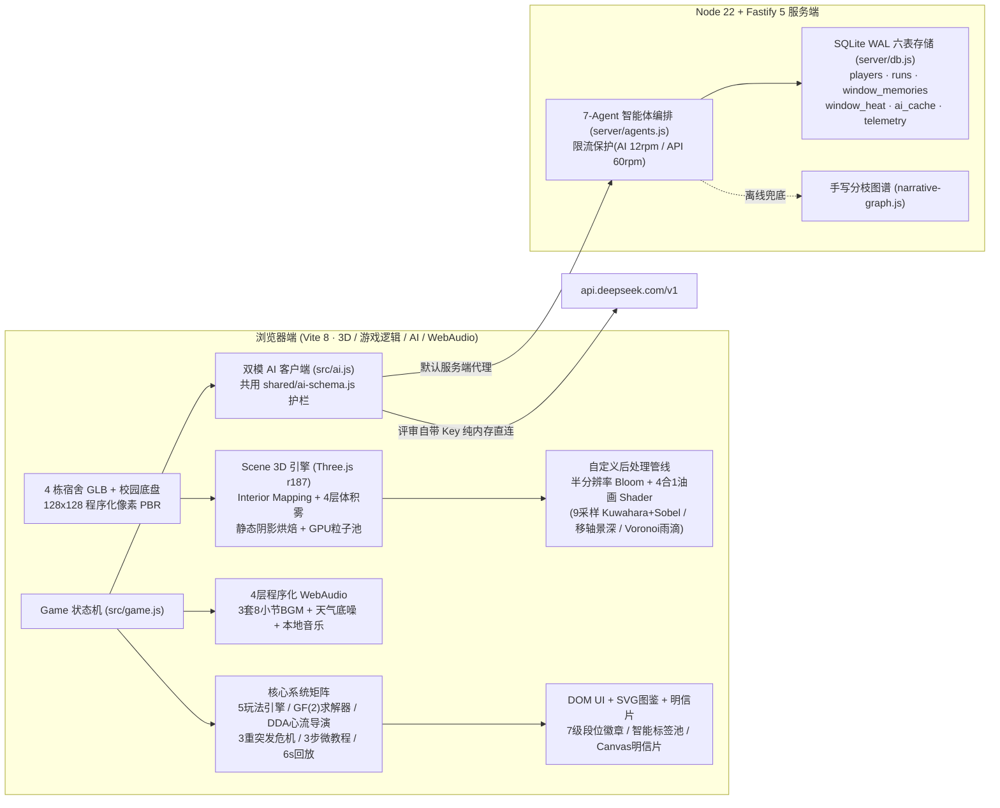

# 《今晚，亮一盏灯 · Light A Window v5.1》参赛项目说明与全功能设计白皮书

> **参赛赛事**：心晴校园 AI 创意挑战赛（活动 ID: 39 · 主办：衡阳师范学院计算机科学与技术学院）  
> **在线体验地址**：[https://game.xiaoxin.email/](https://game.xiaoxin.email/)  
> **定位一句话**：基于 **Blender 3D 校园建筑群 + 自定义 GLSL 像素油画后期 + 7-Agent 双模 AI 导演** 的治愈系 3D 校园夜巡多玩法游戏。

---

## 1. 30 秒评审速览

| 评审关注维度 | 本项目硬核实现与实测数据 |
|---|---|
| **包体与首屏性能** | 生产包总大小仅 **`5.63 MB`**（远低于 30 MB 赛事上限），含 5 份校园 Blender GLB + Three.js 分块打包；**零外部图片/音频文件下载依赖** |
| **实时渲染帧率** | 满画质 Quality 3 + Bloom 开启下（1280×720 无头 Chromium），本地实测平均帧耗时 **`11.17 ms`（≈ 89.5 FPS）**，线上实测 **`11.77 ms`（≈ 85 FPS）**，`gl.getError() === 0` |
| **交互玩法厚度** | 1 套引导微教程 + **5 大并列玩法**（剧情夜巡三晚六结局 / 依次记忆 10 关 / 快照记忆 10 关 / 查寝夜猫子 5 波 / GF(2) 熄灯棋盘 8 关）+ 4 栋差异化宿舍楼 + 4 季 5 天气 |
| **AI 工程与隐私** | **7 个具名智能体**（开局/演进/回信/对话/构图/点评）贯穿局前、局中与局后；支持**评审自带 DeepSeek Key 纯内存直连**（不写存储/不经本服/刷新即清），同时具备 SQLite 语义缓存与离线手写图谱三级降级 |
| **工程质量门禁** | ESLint 9（0 警告/0 错误）+ TypeScript 7 `checkJs: true`（全 `.js` 零错误）+ **295 条 Vitest 单元与 API 集成测试** + **217 条 4 层 Playwright 端到端测试** = **512 条自动化校验** |

---

## 2. 选题背景、主题表达与差异化设计策略

1. **跳出「功能堆叠树洞 / 心理测评」红海**  
   针对校园同类作品常见同质化（日记本、问卷量表、纯对话树、呼吸圆环），本作以大学生最有共鸣的日常时空——**宿舍夜间十一点熄灯查寝**为叙事母题，通过「顺滑一笔画点亮微光」「为晚归室友留门灯」「抓走偷蹭猫条的校领导胖橘」「在 3000W 螺蛳粉小电锅跳闸前排障」等幽默烟火细节，带来温和的情绪降压与陪伴感。
2. **严守伦理边界，拒绝临床说教**  
   全作定位为治愈系解压游戏而非心理测评或治疗工具。在前后端共享校验层 `shared/ai-schema.js` 中强制内置 **12 词临床与说教禁用过滤表（`BANNED_WORDS`）**，从源头杜绝 AI 生成生硬说教或越界医疗措辞。

---

## 3. 系统总体架构

### 3.1 总体架构图

### 3.2 技术栈选型与工程组织

| 层级 | 技术选型 | 工程选型依据 |
|---|---|---|
| 3D 资产与管线 | **Blender Python** (`tools/blender/build_campus_v4.py`) + **Three.js r187** (`EffectComposer`) | 四栋建筑实景精确对齐 `window_r_c` 命名挂点，分拆 `three-core` 与 `three-examples` 独立 chunk 优化首屏缓存 |
| 静态类型安全 | **TypeScript 7 (`checkJs: true`) + JSDoc** | 全量 `.js` 源码在免编译前提下通过强类型契约校验 |
| 前后端同构层 | **`shared/`** (`constants.js`, `ranks.js`, `ai-prompts.js`, `ai-schema.js`) | 零第三方依赖，保证直连 DeepSeek 与服务端代理共用完全一致的 Prompt、安全词过滤与段位门槛 |
| 后端与数据库 | **Fastify 5 + Node 22 内置 `node:sqlite`** | 开启 WAL 日志、64MB 页缓存与内存临时表；免除原生 C++ 编译依赖，单核 4G 服务器高并发稳健运行 |
| 质量门禁 | **ESLint 9 + Vitest 5 + Playwright 1.65** | 295 条单元/集成用例 + 217 条四层 E2E 自动化验证 |

---

## 4. 全功能设计详述（F1 – F12）

---

### F1 · Blender 3D 校园建筑群与程序化像素-油画 PBR 材质管线

- **对应源码**：`tools/blender/build_campus_v4.py`、`src/textures-procedural.js`、`src/scene.js`、`shared/constants.js`
- **设计细节**：
  1. **五套实景 GLB 模型**：无头 Blender 脚本生成 `campus_grounds.glb`（石板广场、卵石主道、复古路灯杆、四季植被集群、夜猫子围墙）及 4 栋差异化窗阵宿舍楼——`dorm_staff.glb`（3×4=12 窗 桂花院）、`dorm_highschool.glb`（3×6=18 窗 晨光楼）、`dorm_university.glb`（4×6=24 窗 17 号楼）、`dorm_grad.glb`（5×6=30 窗 研思楼）。模型导出统一度量 `DORM_SCALE = 24.0`，底面落位 `BASE_Y = -210`。
  2. **128×128 高度场切线空间法线生成**：`textures-procedural.js` 基于确定性哈希 `hash2()` 在浏览器启动瞬间合成砖砌错缝、屋顶琉璃瓦、石板路面的漫反射贴图及微法线 `DataTexture`（通过 `heightsToNormalTexture()` 差分斜率转法线贴图），让 Blender 素模具备星露谷手绘颗粒度与真实受光立体感。
  3. **四档摄影机预设与航拍切换**：预设 `front`（正面连窗 `[0, 32, 920]`）、`stardew`（星露谷 45° 斜视 `[340, 270, 790]`）、`street`（林荫仰望 `[-175, -125, 485]`）、`rooftop`（天台巡礼 `[215, 420, 600]`）；切换宿舍楼时通过 1.35s 抛物线贝塞尔轨道相机航拍中点无缝换楼，配合有界 `OrbitControls`（方位角 `±0.40π`、极角 `0.20π–0.49π`、距离 `400–1280`）防止穿模。

---

### F2 · Interior Mapping 室内视差着色器、窗框溢光与单 Pass 四合一油画后期 Shader

- **对应源码**：`src/scene.js`（`_createInteriorMaterial`, `createInteriorAtlas`, `_buildSpillDecals`）、`src/painterly.js`
- **设计细节**：
  1. **Interior Mapping 假室内深景技术**：启动时通过 Canvas 2D 程序化绘制一张 `512×512`（2 行暖/冷色调 × 4 列 128×256 房间原型：书房、卧室、猫爬架客厅、双屏桌）共享图集 `createInteriorAtlas()`。每扇窗户玻璃在自定义 GLSL `ShaderMaterial` 中接收相机局部视线方向向量，通过单次射线-房间盒交点投影映射深度 UV，在零额外 3D 室内几何体开销下实现「左右移动视角能窥见屋檐桌椅立体位移」的拟真视觉效果；同时保持 `transparent: true` 兼容层契约并隐藏原冗余 `backPanel`/`silhouette` 网格以削减 60 个 Draw Call。
  2. **InstancedMesh 墙面溢光贴花**：`_buildSpillDecals()` 用单个 `InstancedMesh` 批处理所有亮灯窗对下方外墙红砖造成的暖色投射光晕，随窗户状态实时同步矩阵与实例色。
  3. **自定义四合一全屏后期管线（`PainterlyShader`）**：在三通道线性渲染与半分辨率 `UnrealBloomPass(threshold: 0.90, strength: 0.45, radius: 0.42)` 之后，单 Pass 融合 4 层质感：
     - **9 采样合并 Kuwahara + Sobel 油画笔触滤波**：将传统 16+8 次纹理读取数学合并为共享 3×3 邻域的 9 采样方案（`uFastMode > 0.5` 降至 5 采样十字滤波）；引入 **Tilt-Shift 移轴景深**（按屏幕垂直焦区 `uTiltShiftCenter/Range` 动态缩放笔触半径）并在发光窗芯自动收敛半径以守住室内剪影锐度。
     - **双尺度彩色手绘墨线**：依据像素局部色温（`baseCol.r - baseCol.b`）在深群青（`#14182e`）与暖焦茶（`#382214`）之间动态混色，背光/轮廓峰值处叠涂月亮金勾边（`#ffc98a`），并用单次 `vnoise` 模拟干画笔断墨。
     - **解析法亚麻 Impasto 厚涂高光**：用 `sin/cos` 解析导数直接求得亚麻经纬微凹凸法线 `N`，替代 3 倍有限差分 `fbm2` 调用，显著减少片元算力；暗部托底融入羊皮纸暖底调，并支持 `uComboVignette` 随连击收紧暗角聚焦视线、`uDawn` 渐变玫瑰金破晓调色。
     - **双层 Voronoi 玻璃雨滴折射**：仅当 `uRainAmount > 0.001` 时激活双尺度下落水珠与半月形暖光边缘高光折射，晴天零损耗。

---

### F3 · 四季动态生态与真实校园气象系统

- **对应源码**：`src/scene.js`（`_buildVolumetricFog`, `_buildPuddleOverlay`, `_buildWeather`, `_buildSeasonParticles`, `setSeason`, `setWeatherFx`）、`shared/constants.js`
- **设计细节**：
  - **真天气物理渲染**（彻底取代旧版用雪点代替雾效的简易做法）：
    - `fog` 浓雾：4 层双八度 FBM 体积雾平面（`_buildVolumetricFog`）搭配路灯位置指数级米氏散射池与路灯放大光晕（`scale 74 → 128`）；
    - `light_rain` 细雨：1400 粒雨滴点群 + 地砖平面自定义 `ShaderMaterial` 同心水波涟漪 `_buildPuddleOverlay()`（受全楼暖光亮度 `uWarmGlow` 染色）+ 湿滑高光地面；
    - `snow` 落雪 & `winter` 冬季：900 粒雪花与 `_syncSnowVisibility()` 同步显示屋檐窗台积雪网格并重新烘焙阴影；
    - `wind` 晚风：风力目标值拉升至 `3.0`，加速全局摇曳 `uWindStrength` 驱动树冠与晾衣绳动画；
    - **四季粒子**：春粉樱花（16px）、夏金流萤（13px）、秋琥珀银杏叶（17px）、冬冰晶（13px），以及常驻屋顶水塔巡视猫生态。

---

### F4 · 60+ FPS 高帧率优化与 4 档自适应画质引擎

- **对应源码**：`src/scene.js`、`src/vfx-pool.js`、`src/ribbon-trail.js`、`src/ui.js`
- **设计细节**：
  1. **静态阴影烘焙**：关闭每帧实时 ShadowMap 刷新（`renderer.shadowMap.autoUpdate = false`），仅在建筑初始化、切楼模型加载完毕或雪景可见性改变时调用 `_bakeShadows()` 单帧重绘，大幅降低 GPU 顶点遍历成本。
  2. **半分辨率 Bloom & 智能 DPR 封顶**：`UnrealBloomPass` 分辨率与屏幕呈半宽高比例，`renderer` 默认物理像素比上限桌面锁 `1.5`、触屏端 `1.25`。
  3. **暗窗精灵全剔除**：暗窗状态下的 `glow`/`halo`/`beacon` Sprite 当实际透明度 `< 0.008` 时直接置 `visible = false` 跳过混合填充。
  4. **零 GC 特效双引擎**：
     - `VfxPool`（1024 容量单 `THREE.Points` + GPU 顶点着色器）：全场景爆闪共用一张缓冲，发射粒子仅覆盖 TypedArray 环形游标，运行期零对象新建与垃圾回收停顿；
     - `RibbonTrail`：预分配 48 采样点 × 4 细分 Catmull-Rom 流体金粉尾翼与磁吸纠偏，实现跟手顺滑无抖动的拖连刀光。
  5. **UI/SVG 零重排对象池**：`updateWindowTags()` 固定复用最多 4 枚 `.win-tag` 胶囊且仅在位置/文案变化时写属性（彻底清除每帧 `innerHTML` 重建与 `backdrop-filter: blur` 合成开销）；`updateTutorialGesture()` 缓存点位 Key，每帧仅修改手势 `<g>` 节点 `transform` 属性。
  6. **60 FPS 自适应画质控制器**：基于 60 帧环形毫秒缓冲均值——连续 `1.2s` 均值 `> 18.8ms` 触发温和降档，连续 `5.0s` 均值 `< 13.5ms` 自动升档；且在 **Quality 1–3 全档位保持 Interior Mapping 启用**，杜绝切换画质触发 GLSL 重新编译导致的瞬时掉帧卡顿。

---

### F5 · 三步互动微教程状态机与全链路空间导览

- **对应源码**：`src/tutorial.js`、`src/game.js`、`src/ui.js`、`src/scene.js`
- **设计细节**：
  - **确定性五态教学机（`TutorialStateMachine`）**：`idle -> step1_tap -> step2_drag -> step3_bridge -> done`（另含 `abort()` 中止态与 `localStorage` 容错读写 `lal_tut_v5`）。12 秒无操作时温和发出卡片脉冲提示 `pulseTutorialInactivity`。
  - **教学态交互守卫**：第 2 步断划半途松手触发自动重武装（恢复 3 扇微光并提醒），杜绝教学软锁；步骤切换与退出/结算瞬间执行 `_cleanupTutorialUi()`，确保零残余 SVG 路径、提示气泡与教学卡片。
  - **立体导览层**：3D 两侧楼层标牌 Sprite（1F–5F）配合任务雷达脉冲、智能互斥优先级胶囊标签（最多 4 个：`危机 > 星桥 > 信标`）、默认开启防误触的「🔒 固定连窗」开关，降低上手门槛。

---

### F6 · 五大并列玩法引擎与多维难度算法

- **对应源码**：`src/minigames/memory-patrol.js`、`src/minigames/dorm-reflex.js`、`src/minigames/lights-out.js`、`src/game-logic.js`、`src/game.js`
- **各玩法核心数学设计与算法细节**：
  1. **依次 / 快照记忆 (`memory-patrol.js`, 10 关)**：
     - 目标窗数：`targetCount = min(min(W-1, max(4, floor(W * 0.72))), 3 + floor((L-1)*0.95))`
     - 展示压缩曲线：依次单亮 `stepShowMs = max(210, round(740 - (L-1)*62))`、间隔 `stepGapMs = max(65, round(210 - (L-1)*18))`；快照全亮 `snapshotShowMs = max(650, round(2400 - (L-1)*210))`
     - **干扰与记忆留白机制**：第 3 关起加入 `1–4` 扇 `DECOY_BLUE` 干扰窗；第 4 关起开启 `interleaveDecoys = true` 交错穿插；第 6 关起注入 `blackoutMs = min(900, 350 + (L-6)*140)` 观测后全黑停顿；最大容错收紧为 `3 -> 2 -> 1`；复现限时 `recallSeconds = max(8, round(12 + targetCount*1.9 - (L-1)*0.45))` 并按剩余时间发放速度奖。
  2. **查寝夜猫子 (`dorm-reflex.js`, 60 秒 5 波)**：
     - 按 12 秒切分 5 命名波次（热身查寝 / 熄灯突击 / 宿舍躁动 / 宿管暴走 / 零点极限），刷新间隔 `960ms -> 360ms`，目标存活 `2550ms -> 1200ms`，同屏上限 `3 -> 10`；第 4–5 波启用 `doubleSpawnChance = 0.35` 同帧双窗并发，且熬夜蓝窗超时未扑灭将打断连击。
  3. **全楼归眠熄灯棋盘 (`lights-out.js`, 8 关限时)**：
     - **100% 可解生成**：由全暗盘面执行 `min(floor(n*0.72), 2 + ceil(L*1.45))` 次不重复十字翻转生成题目，并用高斯消元逆推最优解步数 `parMoves`。
     - **精确 `GF(2)` 高斯消元提示器 (`solveLightsOutGF2`)**：针对任意 $N = \text{rows} \times \text{cols}$（12/18/24/30）构造 $N \times (N+1)$ 二元域 `Uint8Array` 增广矩阵进行消元求解，在奇异解/自由元棋盘下回代求解，使「💡 提示」按钮 100% 给出真实可通关的一步按键。
     - 每关限时空降 `52s -> 28s`，通关步数 `<= parMoves` 触发 `★★★ 最优解 +120` 奖励。
  4. **剧情夜巡 (`game-logic.js`, 3 晚 6 结局)**：
     - 5 态窗格与 `gainForDragChain(combo, k) = gainForCombo(combo) + 2 * min(k, 5)` 一笔画公式；
     - 委托自缩放器 `adaptCommissionsForDorm()` 与星桥拓扑适配器 `adaptResonancePairForDorm()` 确保 12/18/24/30 四种楼型委托 100% 可达成；
     - 6 结局严格按条件特异性优先级路由（见玩法手册 4.1E）。

---

### F7 · 心流动态难度导演（DDA）、突发危机与整层制霸

- **对应源码**：`src/difficulty.js`、`src/crisis.js`、`src/game-logic.js`
- **设计细节**：
  - **DDA 心流调节器 (`DifficultyDirector`)**：统计最近 `windowSize = 12` 次操作的实时准确率 `hitRate`，对照目标心流带宽 `[0.70, 0.85]`：
    - 过高（`>0.85` 顺手）→ 缩短刷新间隔与留灯时长，轻微引入干扰概率；
    - 过低（`<0.70` 吃力）→ 放宽微光停留至 `1.25x`、清零干扰并提示 `宽松` 状态；
    - 经 EMA 平滑（`alpha = 0.3`）并硬钳制于 `[0.80, 1.25]`，平稳隐身护航体验。
  - **校园突发危机 (`CrisisManager`)**：每 75 秒夜巡在 `[18, 26]s` 与 `[44, 56]s` 调度两场不重复危机（螺蛳粉跳闸连点 3 次、跳窗橘猫跨房追点、蓝牙麦拔麦），与信标及星桥**互斥推迟 4s**，防止事件重叠混乱；超时不扣分只错失奖励，保持零挫败体验。
  - **整层制霸 (`floorCleared`)**：实时侦测某楼层全列点亮，触发 +18 温暖、楼层黄金扫光扫描动画与专属音阶音效。

---

### F8 · 多智能体 AI 协同架构与隐私安全护栏

- **对应源码**：`server/agents.js`、`src/ai.js`、`shared/ai-prompts.js`、`shared/ai-schema.js`
- **七位智能体职责与分工路由**：

| 触发时机 | 路由 / 接口 | 智能体角色 | 核心产出（强类型 JSON 结构化） |
|---|---|---|---|
| 开局剧情选毕 | `POST /api/agent/plan`（3.8s 竞速） | **NightDirector** + **ResidentPersona** | 生成三晚节奏/天气/色盘/委托/星桥配对及 6 住户多夜对话与抉择枝 |
| 第 1 晚第 45 秒 | `POST /api/agent/evolve` | **ResonanceWeaver** | 基于第 1 晚点亮数、连击、抉择偏好，**深拷贝仅改写第 2、3 晚未来剧本**，绝不污染当前夜晚 |
| 第 3 晚终局 | `POST /api/agent/epilogue` | **ChronicleCurator** | 结合深羁绊住户生成定制署名手写信与留声机建议寄语 |
| 进入 / 切换宿舍 | `POST /api/agent/dialogue` | **DialogueDirector** | 结合天气/季节/宿舍特征创作值班室开场动态 NPC 对话流 |
| 记忆挑战各关前 | `POST /api/agent/puzzle`（1.1s 竞速） | **PuzzleArchitect** | 设计对称/对角/星轨等可读性几何亮灯窗格坐标与阵列雅称 |
| 小游戏结算时 | `POST /api/agent/debrief` | **InspectorCommentator** | 以林阿姨与周副校长双视角给出个性化巡查评语与助眠小贴士 |

- **双模安全机制与三级容错降级**：
  1. **三级降级保障零死机**：`SQLite ai_cache 语义缓存` → `上游 DeepSeek API（可配置模型代理）` → `全手写离线图谱（src/narrative-graph.js / src/npc-portraits.js）`。
  2. **自带 Key 纯内存直连隐私设计**：评审/玩家在客户端填入自己的 DeepSeek API Key 时，`setUserApiKey()` 将其仅保存于 `src/ai.js` 模块私有闭包变量 `_memoryApiKey`，并通过 `verifyUserApiKey()` 发送 `max_tokens: 1` 探针真实验证（明确区分 `401`/`402`/`429` 状态）。直连请求直接从浏览器发往 `https://api.deepseek.com/v1/chat/completions`，**不落 `localStorage`/`Cookie`、不上传本项目服务器、刷新或关闭页面即销毁**。
  3. **同构 Schema 护栏**：直连与代理路径均运行同一份 `shared/ai-schema.js` 校验——非法天气/色盘自动就近映射、越界房间重绑定到当前宿舍拓扑、超长截断、非法 Emoji 由 `ALLOWED_ICONS` 过滤防系统字体渲染“豆腐块”，命中 12 个临床禁用词即整包拒绝并无感降级。

---

### F9 · 四层自适应 WebAudio 程序化音景引擎

- **对应源码**：`src/audio-engine.js`
- **设计细节**：全程零 MP3/WAV 打包，依靠 Web Audio API 实时波形、带通滤波器与粉红/棕褐噪声合成 **4 层动态声场**：
  - **L1 天气噪声底噪**：随 `weather` 平滑切换细雨水滴声（`1500–3600Hz`）、呼啸风压 LFO 调频与静夜底噪；
  - **L2 随点亮增长的温暖 Pad**：三组失谐三角/正弦叠加和弦（`Fmaj7 -> G6 -> Em7 -> Am9`），随当晚点亮窗数动态打开低通截止频率与立体声泛音闪烁；
  - **L3 五声音阶交互旋律**：C 大调五声音阶（C5–E6）马林巴颗粒音、随一笔画连窗数 $k$ 音高阶梯递增的 `chainNote()` 与共鸣竖琴滑奏；
  - **L4 住户/事件拟音 & 三套 8 小节总谱**：内置 **《黄昏之时风》**(A大调 78 BPM 钢琴+钢片琴)、**《医龙 · 苍蓝脉搏》**(D小调 114 BPM 脉冲弦乐+定音鼓/军鼓)、**《My Soul · 子夜琴诗》**(F#小调 88 BPM 碎拍钢琴)，支持按场景自动调度、一键切歌或导入本地音乐文件混音播放。

---

### F10 · 7 级夜巡段位体系、6 秒回放剧场与纪念明信片

- **对应源码**：`shared/ranks.js`、`src/replay.js`、`src/postcard.js`、`src/ui.js`
- **设计细节**：
  - **跨端统一段位标尺 (`shared/ranks.js`)**：`D`（见习点灯生）到 `SSS`（全校熄灯传说）依据不同模式的得分曲线校准独立门槛，配合直观关数里程碑（如「闯到 第 7/10 关」「守到 第 4/5 波」「解开 第 6/8 关」），于 HUD 实时追踪、升级 Toast 提示、结算勋章进度条及排行榜行集中体现。
  - **6 秒 12.5 倍速今夜回放 (`ReplayRecorder` / `ReplayPlayer`)**：局内用最多 400 条记录的环形缓存（<20 KB 内存）记下每次点亮、拖链、共鸣与危机时刻；终局结算出卡片后可就地以约 12.5× 倍速重播整夜光路历程（彻底隔离计分态且监听异常不会崩溃循环）。
  - **1080×1440 真实映射纪念明信片 (`drawPostcard`)**：Canvas 2D 生成可下载高清 PNG 明信片，楼体上每一格窗格的暖亮度严格对应本局 `litRoomIds` / 各夜点亮频率，附带结局色盘梯度与定制回信签名。

---

### F11 · SQLite WAL 六表持久化与异步校园社区

- **对应源码**：`server/db.js`、`server/index.js`、`src/records.js`
- **设计细节**：
  - **6 张结构化表（开启 `WAL`、`64MB` cache）**：
    1. `players`：匿名 `uid`、6 位大写可读找回码（规避易混 `0/O/1/I`）、昵称、历史总窗数/最佳温暖/连击、解锁结局/物件/住户羁绊/称号；
    2. `runs`：全模式对局日志（含 `game_mode`、`dorm_type`、`season`、`weather`、`stage_reached`、`correct_count`、`accuracy_pct`、`score`），启动时幂等执行 `ALTER TABLE` 无损迁移旧版数据；
    3. `window_memories`：**流光留声机**，房间级别跨玩家匿名留言（最大 40 字安全过滤）与共鸣点赞计数；
    4. `window_heat`：驱动标题页建筑背景「全服各房间热度灯图」；
    5. `ai_cache`：基于 FNV-1a 哈希与桶化策略的 AI 语义命中复用缓存；
    6. `telemetry_events`：只存脱敏事件名与数值摘要的轻量运行遥测。
  - **分榜检索与差值追赶**：`/api/leaderboard` 支持「全部/今晚 × 5 玩法 × 4 宿舍楼」精准筛选，并计算当前玩家真实名次、超越百分比及与前一名（附对方段位及闯关深度）精确积分差。
  - **服务端防刷与内存自净**：开启 `trustProxy` 区分反代后真实访客 IP，AI（12 req/min）与数据（60 req/min）双桶限流器配合周期清扫定时器避免 `Map` 泄漏。

---

### F12 · 自动化质量门禁与生产运维部署体系

- **对应源码**：`package.json`、`tests/`、`playwright.config.js`、`deploy/deploy.sh`
- **设计细节**：
  - `npm run verify` 串联四重静态与动态门禁：**ESLint 9** → **TypeScript 7 `checkJs`** → **Vitest 5（12 套件 295 用例）** → **Vite 8 生产构建**。
  - **Playwright 四层端到端回归（217 用例）**：覆盖 Tier 1 核心特性全检（100 例）、Tier 2 边界降级与 GL 状态校验（100 例）、Tier 3 跨特性交叉组合正交覆盖（12 例）及 Tier 4 完整剧本/连击/多夜回放/移动端竖屏触控真实场景（5 例）。
  - **生产部署与回滚脚本**：`deploy/deploy.sh` 自动构建并校验 `dist/` 资产完整性（4 chunk + GLB），上传 `.staging` 后同时备份前端与后端，**永不触碰 `/opt/light-a-window/data` 数据库目录**，重启 `light-a-window` 服务后自动轮询 `/api/health` 与 `/api/bootstrap`，支持单命令 `--rollback` 秒级回退。

---

## 5. 四大比赛奖项对照与差异化举证

| 比赛奖项 | 本作对应核心亮点与实测举证 |
|---|---|
| **最佳视觉设计奖** | **统一手绘绘本夜景母题**：Blender 4 栋差异化建筑 + 128×128 像素法线贴图 + 单 Pass 融合 **Interior Mapping 室内视差 + 9 采样 Kuwahara 油画滤波 + 双尺度变温墨线 + 亚麻纹理高光 + Tilt-Shift 移轴景深 + Voronoi 雨滴 + 4 层 FBM 体积雾 + 5 套天候动态装束立绘**，从 3D 世界到 1080×1440 明信片视觉语言高度自洽 |
| **最佳交互体验奖** | **零门槛、高正反馈的多端手感**：30 秒三步互动教学（断划自动重武装、零残余清理）+ 60 秒进入核心连光；默认防误转「锁定连窗」与右键/双指自由看楼一键切换；1024 容量 GPU 粒子 + Catmull-Rom 磁吸光带 + 五声音阶攀升音高 + 整层黄金扫光；所有失误均有护盾或零挫败温柔保底，本地/线上实测 **`85–89.5 FPS` 满帧运行** |
| **最佳 AI 技术应用奖** | **AI 不当聊天框，而是直接驱动场景、关卡与叙事分支**：7 位具名智能体通过结构化 JSON 驱动夜景调色、3 晚命运改写（仅修改未来夜晚）、几何亮灯阵、天气开场对白与结算点评；**前后端同构 `shared/ai-schema.js` 安全护栏**拦截 12 类临床禁用词与非法坐标；**评审自带 DeepSeek API Key 纯闭包内存直连（含真实探针校验、刷新即清、决不落盘）** + 三级离线降级保底 |
| **最佳工程奖（完成度奖）** | **产品级交付质量与可验证可运维体系**：整体包体仅 **5.63 MB**（限额 30 MB）；`ESLint + checkJs` 零警告/零错误；**295 单元/API 用例 + 217 端到端 Playwright 用例（共 512 条）全绿通过**；已上线独立生产服务器（HTTPS、Nginx 反代、SQLite WAL、限流自净、一键备份回滚与真实全网排行榜） |

---

## 6. 隐私安全与原创素材版权声明

- **版权纯正**：全部 3D 模型由自写 Blender Python 脚本生成，全部墙体瓦片 PBR 贴图、窗户室内图集、SVG 角色换装立绘、WebAudio 合成乐曲及玻璃图标均由项目源码原创实时或程序化生成，**未打包任何第三方商用或来源不明图像与音频资源**（详见 [ASSET_LICENSES.md](../ASSET_LICENSES.md)）。
- **隐私合规**：严格遵循「最小化匿名数据」与「Key 仅驻留内存」承诺（详见 [PRIVACY.md](../PRIVACY.md)），不收集真实身份、IP 明文或敏感心理隐私。

---

## 7. 评审 3 分钟实机演示推荐路线

1. **0:00 – 0:30｜标题页 & AI Key 可选配置**：观察 3D 校园夜巡航拍与背景「全服点亮热力图」，点开「AI Key 配置」确认浏览器直连验证与纯内存说明（或直接用自带默认云端管线继续）。
2. **0:30 – 1:10｜进入 3D 校园大厅与环境切换**：体验开场 NPC 对话与换装，大厅内切换一次**「研究生宿舍 30 窗」+「细雨/落雪/浓雾」+「春/秋/冬」**，自由拖转视角观察 **Interior Mapping 室内视差**与地面涟漪/体积雾。
3. **1:10 – 2:10｜剧情夜巡核心循环**：进入第 1 夜完成或体验**三步交互教学**（重点感受按住拖连光带的丝带拖尾与竖琴递升、星桥共鸣、触发吃瓜抉择时倒计时自动冻结与随机突发危机排障）。
4. **2:10 – 3:00｜小游戏硬核实力 + 榜单段位**：返回大厅体验 **「熄灯解谜（点 💡 提示看 GF(2) 高斯消元一步精确标星）」** 与 **「依次/快照记忆」** 展示段位实时徽章（`D`→`SSS`）及排行榜单各同学真实闯关深度对比。
