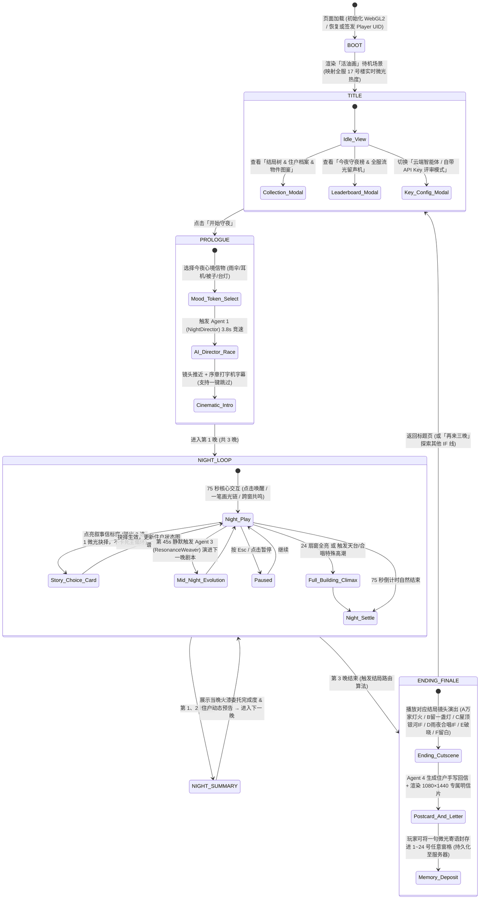

# 00 · 《今晚，亮一盏灯 v3.0》商业化重制总纲与系统架构蓝图

> **文档定位**：本目录（`docs/v3_plan/`）为《今晚，亮一盏灯 · Light A Window》v3.0 商业化重制版的**最高执行契约（Single Source of Truth）**。  
> **阅读对象**：负责具体代码编写、美术管线执行、前后端联调与自动化测试的 AI 执行模型（Execution Agents）及开发者。  
> **执行铁律**：执行模型必须严格按照本套计划中的架构、状态机、数学公式、Shader 算法、API 契约与 Prompt 规范进行全量实现，**严禁偷工减料、严禁写空壳占位符（Stub/TODO）、严禁破坏既定接口契约**。

---

## 一、 为什么需要 v3.0 全面重制？（现状痛点清算）

对现有 v2.1 仓库的审查表明，当前版本只是一个「能跑通基础点击的粗糙原型」，距离「商业化上架水准」与「赛事大满贯（视觉/交互/AI/工程四项大奖）」存在四大结构性代沟：

1. **玩法与叙事空洞，甚至存在主循环反转 Bug**：
   - 现有代码把「窗户微光待点亮」直接写成了「后台定时器自动点亮（`scene.litWindow`）」，导致玩家挂机 30 秒整栋楼自动全亮；而玩家按提示去点亮窗时提前 `return`，所有惊喜事件、水波纹、窗后故事全部断路。
   - 24 扇窗毫无记忆与关联，三晚只是机械重复点击，缺乏**短期微目标（每晚委托）**、**中期操作爽感（一笔画光链/跨窗共鸣）**与**长期叙事驱动（常驻角色连续剧情 + 多结局 IF 线）**。
2. **4核4G 服务器算力与存储被严重浪费**：
   - 服务器仅存了一张简单的分数表，玩家的结局收集、图鉴解锁、历史夜景以及跨玩家的「留灯共鸣」完全没有做服务端持久化。
   - 且后端 Fastify 未开 `trustProxy: true`，Nginx 反代后全网共用 `127.0.0.1` 的 20 次/分限流桶，极易全站 429。
3. **AI 应用流于表面，缺乏真正的 Agent 智能体深度**：
   - 现有 AI 仅在开局发一次静态请求生成 6 句短文，且 `tempo` 参数完全未接入玩法。玩家在局内的操作对后续夜晚毫无影响，无法体现 Multi-Agent 协同、上下文记忆与动态剧情演进（Adaptive Narrative）。
4. **视觉与交互技术力尚未完全释放**：
   - 现有 `painterly.js` 仅做了微弱的亮度 Sobel 和简单噪声，画面仍像「普通 3D 几何盒」，缺乏真正的**各向异性桑原滤波（Anisotropic Kuwahara Filter）油画笔触**、**法线画布凹凸受光**与**多层视差室内景深（Parallax Interior）**。
   - 缺少丝滑的**拖拽流体尾翼（GPU Ribbon Trail）**、**静止画面的二阶弹簧视差（Living Painting Idle Dynamics）**，且每次点击新建销毁 `BufferGeometry` 存在 GC 卡顿隐患。

---

## 二、 v3.0 产品核心愿景与商业化升级定义

### 2.1 核心定位升级
- **一句话定义**：一款**「厚涂油画风 · 3D 视差微缩校园 · 多智能体驱动的快节奏治愈系解压游戏」**。
- **核心体验公式**：
  $$\text{商业级上瘾感} = \text{零延迟点滑爽感 (Click + Ribbon Drag)} \times \text{每晚手账微委托 (Goals)} \times \text{6大常驻住户连续剧与多结局 IF 线 (Narrative)} \times \text{跨玩家微光留声机 (Async Social)}$$

### 2.2 四大维度技术力标杆

| 维度 | v2.1 现状 | v3.0 商业化重制目标 |
|---|---|---|
| **游戏内容与叙事** | 无主线、无目标、挂机自动亮窗、单结局 | **「17号宿舍楼的最后一学期」**：5 态窗格系统 + 一笔画光链 + 跨窗星轨共鸣 + 每晚 3 项火漆印章委托 + 6 位常驻角色 3 晚连续剧情与微光抉择 + **6 大结局（含天台星空 IF 线、雨夜合唱 IF 线、破晓线等）** + 4C4G 云端全量持久化与跨玩家「流光留声机」 |
| **美术与动态表现** | 简单 Box + 极弱 Sobel 描边 + 平面贴图 | **三层真油画管线**：Blender 精细校园微缩场景（或高精程序化+GLB 混合）+ **3D 视差室内盒（Parallax Interior Box）** + AI 批量厚涂贴图 + **Anisotropic Kuwahara 各向异性桑原油画滤波 + 深度/法线双通道墨线 + Impasto 画布高光 + 屏幕雨滴折射** |
| **交互与高帧率架构** | 仅单击、DOM 频繁重建、每次点击新建 Geometry | **120FPS 零 GC 架构**：**Catmull-Rom GPU 流体拖拽尾翼** + 磁吸悬停预判 + 全局单 `InstancedBufferGeometry` 环形粒子池 + 二阶弹簧物理（Spring Damper）镜头视差 + 分层自适应 WebAudio 动态交响音轨 |
| **AI 多智能体引擎** | 单次静态 Prompt，局内零交互 | **4-Agent 协同管线**：`NightDirector`（导演与委托编排）+ `ResidentPersona`（住户状态机与微抉择）+ `ResonanceWeaver`（局中第 45s 根据玩家真实行为流式演进后续夜晚）+ `ChronicleCurator`（多结局审判与住户手写回信），支持服务端代理与浏览器内存 Key 双模式 |

---

## 三、 v3.0 计划文档分卷索引

执行模型在动工前，必须按顺序阅读以下 6 份分卷规格书：

| 分卷文件 | 负责领域 | 核心产出模块 |
|---|---|---|
| [01_GAMEPLAY_AND_NARRATIVE_DESIGN.md](file:///c:/Users/29602/Desktop/bu-game-psy/docs/v3_plan/01_GAMEPLAY_AND_NARRATIVE_DESIGN.md) | 玩法系统、数值公式、角色剧情、6大结局 IF 线 | `src/game-logic.js`, `src/narrative-graph.js`, `src/game.js` |
| [02_MULTI_AGENT_AI_ARCHITECTURE.md](file:///c:/Users/29602/Desktop/bu-game-psy/docs/v3_plan/02_MULTI_AGENT_AI_ARCHITECTURE.md) | 4-Agent 智能体架构、Prompt、局中演进、双模式 | `shared/ai-schema.js`, `server/agents.js`, `src/ai.js` |
| [03_ART_BLENDER_AND_SHADER_PIPELINE.md](file:///c:/Users/29602/Desktop/bu-game-psy/docs/v3_plan/03_ART_BLENDER_AND_SHADER_PIPELINE.md) | Kuwahara 油画 Shader、3D 视差窗、Blender 与生图 | `src/painterly.js`, `src/scene.js`, `tools/blender/build_campus_v3.py` |
| [04_INTERACTION_VFX_AND_120FPS_ENGINE.md](file:///c:/Users/29602/Desktop/bu-game-psy/docs/v3_plan/04_INTERACTION_VFX_AND_120FPS_ENGINE.md) | 拖拽流体尾翼、粒子池、弹簧视差、动态音轨、毛玻璃 UI | `src/vfx-pool.js`, `src/ribbon-trail.js`, `src/audio-engine.js`, `src/ui.js`, `src/style.css` |
| [05_BACKEND_PERSISTENCE_AND_DEPLOY.md](file:///c:/Users/29602/Desktop/bu-game-psy/docs/v3_plan/05_BACKEND_PERSISTENCE_AND_DEPLOY.md) | 4C4G SQLite 全量持久化、跨玩家留声机、`hynu.site` 部署 | `server/index.js`, `server/db.js`, `deploy/deploy.sh`, `deploy/nginx-hynu.conf` |
| [06_EXECUTION_PLAYBOOK_FOR_AGENTS.md](file:///c:/Users/29602/Desktop/bu-game-psy/docs/v3_plan/06_EXECUTION_PLAYBOOK_FOR_AGENTS.md) | 7 阶段原子化施工手册、验收门禁与执行 Prompt | `tests/*`, `tsconfig.json`, `package.json` |

---

## 四、 v3.0 目标工程目录树（Target Repository Structure）

```text
game-light-a-window/
├── index.html                          # 含 SVG Favicon、OG 分享元数据、字体预加载
├── package.json                        # 升级脚本：dev / build / server / test / lint / typecheck / verify
├── tsconfig.json                       # 开启 checkJs: true, strict: false (渐进严格), noEmit: true
├── vite.config.js                      # 配置 /api 代理与资源分包优化
├── vitest.config.js                    # 单元测试与集成测试配置
├── eslint.config.js                    # ESLint 9 规则集
├── shared/
│   ├── ai-schema.js                    # [升级] 前后端同构校验：三晚剧本、局中演进、结局回信、委托与安全过滤
│   └── constants.js                    # [新增] 前后端共用的结局枚举、房间号定义、色板与天气常量
├── src/
│   ├── main.js                         # 入口组装：Scene + Game + UI + Audio + 全局错误捕获
│   ├── game.js                         # 核心控制器：三晚状态机、点击与一笔画拖拽结算、AI 局中演进调度、多结局触发
│   ├── game-logic.js                   # 纯逻辑函数：5 态窗格转换、连击/拖拽计分、委托判定、6 大结局路由算法
│   ├── narrative-graph.js              # [新增] 17号楼 6 大常驻住户三晚状态图谱、微抉择分支与 6 结局离线完备剧本库
│   ├── scene.js                        # [升级] 3D 微缩校园场景、3D 视差室内窗盒、二阶弹簧镜头、天台星空镜头推拉
│   ├── painterly.js                    # [重写] Anisotropic Kuwahara 油画滤波 + 法线/深度墨线 + Impasto 画布受光 Shader
│   ├── vfx-pool.js                     # [新增] 120FPS 零 GC 环形 GPU 粒子池（颜料迸发、星尘、双层折射波纹、雨滴）
│   ├── ribbon-trail.js                 # [新增] Catmull-Rom 样条动态拖拽流体尾翼（支持一笔画光链与跨窗星轨共鸣）
│   ├── audio-engine.js                 # [新增] 模块化 WebAudio 引擎：粉红雨声/风声 + 动态和弦 Pad + 五声音阶 + 窗户专属拟音
│   ├── ai.js                           # [升级] 双模式 AI 客户端（服务端 Agent 管线 / 浏览器内存自带 Key 直连）+ 局中流式演进
│   ├── ui.js                           # [升级] 高帧率毛玻璃 UI：序章心境选择、HUD 手账委托与火漆章、故事微抉择卡、结局树图鉴、留声机
│   ├── postcard.js                     # [升级] 1080×1440 油画质感明信片合成器（真实映射点亮窗格 + 结局专属插画 + 住户回信）
│   ├── records.js                      # [升级] 本地 localStorage + 服务端云同步双写档案管理（通行证 UID、结局树、图鉴、历史）
│   ├── style.css                       # [升级] 响应式手绘油画风 + 硬件加速毛玻璃 UI 样式表
│   └── vite-env.d.ts                   # 全局类型声明
├── server/
│   ├── index.js                        # [升级] Fastify 5 主服务（开启 trustProxy、分级限流、健康深检、静态托管可选）
│   ├── db.js                           # [新增] Node 22 SQLite (WAL 模式) 6 表持久层封装與预编译语句
│   └── agents.js                       # [新增] 4-Agent 协同编排器（NightDirector / ResidentPersona / ResonanceWeaver / ChronicleCurator）
├── tools/
│   └── blender/
│       ├── proof_of_concept.py         # 原概念脚本（保留归档）
│       └── build_campus_v3.py          # [新增] v3 完整校园微缩场景 GLB 自动化生成脚本
├── public/
│   └── favicon.svg                     # 暖光窗户矢量图标
├── deploy/
│   ├── deploy.sh                       # [新增] hynu.site 一键构建、备份、上传、重载、健康检查与自动回滚脚本
│   ├── nginx-hynu.conf                 # [新增] hynu.site 标准 Nginx 配置（含 SSE 流式支持与静态缓存）
│   └── light-a-window.service          # [新增] systemd 守护进程配置
└── tests/
    ├── ai-schema.test.js               # AI Schema 与安全护栏测试
    ├── schema-helpers.test.js          # 归一化与消毒辅助函数测试
    ├── game-logic.test.js              # 5 态窗户、拖拽光链、委托判定与 6 大结局路由单测
    ├── narrative-graph.test.js         # [新增] 住户剧情分支与离线剧本完备性测试
    ├── records.test.js                 # 本地与云端档案合并测试
    └── server-api.test.js              # [新增] 后端持久层与 Agent 路由集成测试
```

---

## 五、 全链路主状态机（Master State Machine）


