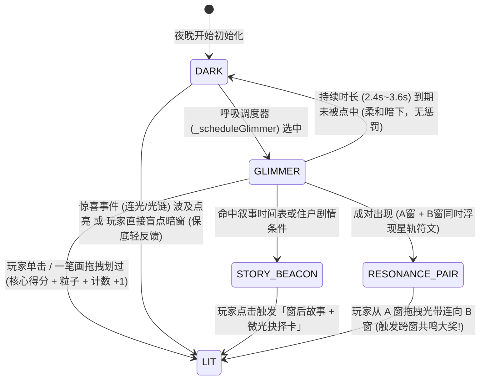

# 01 · 深度玩法、17号楼群像剧情、夜巡委托与多结局 IF 线规格书

> **关联模块**：`src/game-logic.js`、`src/narrative-graph.js`、`src/game.js`、`shared/constants.js`  
> **设计目标**：彻底修复 v2「挂机自动通关」与「点亮窗不触发事件」的致命缺陷，建立**「3 秒上手、每 10 秒有反馈、每晚有小目标、三晚有完整人物弧光与 6 大多结局 IF 线」**的商业级解压可玩性闭环。

---

## 一、 核心窗户状态机重构（5 态窗格系统）

### 1.1 为什么必须重构？
在旧版 `src/game.js` 中，后台定时器 `_lightOne()` 直接调用 `scene.litWindow(w)` 把暗窗变成最终点亮态，导致玩家无需操作楼也会自己全亮；且玩家点击已发光窗户时提前 `return`，跳过了所有惊喜与故事逻辑。

在 v3.0 中，每一扇窗（共 4 层 × 6 列 = 24 扇，编号 `idx: 0..23`，对应房号 `101..106`, `201..206`, `301..306`, `401..406`）必须严格维护以下 **5 种互斥状态**：

### 1.2 5 种状态的视觉、交互与数值定义

| 状态枚举 (`win.state`) | 视觉表现 | 玩家点击 / 拖拽划过时的精确行为 |
|---|---|---|
| `DARK`（沉睡暗窗） | 深普鲁士蓝玻璃，带微弱月光反光与窗框墨线 | **允许点击（零挫败保底）**：不会直接点亮整扇窗，但会产生一圈柔和的微光涟漪与木质轻叩声，获得 `+1` 温暖值，并有 `35%` 概率立即将该窗唤醒为 `GLIMMER` 态（绝不扣分、绝不断连击）。 |
| `GLIMMER`（微光待唤醒） | 窗内透出温暖呼吸柔光（缩放脉冲 `0.97 ~ 1.05`），窗框外浮现一圈手绘感金色呼吸光环 | **核心交互目标**：点击或拖拽划过立即转化为 `LIT` 态！当前晚点亮窗计数 `litCount += 1`，连击 `combo += 1`，获得连击阶梯温暖值（`+3 ~ +8`），迸发颜料星火粒子与双层水波纹，并判定惊喜事件与委托进度。 |
| `STORY_BEACON`（叙事信标窗） | 优先在 6 扇核心住户窗（`102, 203, 205, 301, 304, 406`）上触发；窗外环绕金色星芒与专属物件小图标，持续时间延长至 `12s` | 点击后转化为 `LIT` 态，温暖值 `+8`，立即在底部/侧边呼出**「窗后故事与微光抉择卡」**（含 2 个轻量互动选择，或展示跨玩家留声机记忆）。 |
| `RESONANCE_PAIR`（跨窗共鸣对） | 两扇有关联的窗户同时亮起玫瑰金/星青色双子光环，两窗之间浮现若隐若现的虚线星轨引导 | 玩家按住其中一扇窗，拖出流体尾翼光带连接到另一扇窗，立即触发**「跨窗共鸣（Window Resonance）」**：两扇窗同时转化为 `LIT`，额外点亮路径上经过的 1 扇暗窗，温暖值 `+15`，连击 `+3`，并记录一次 `resonanceCount`（影响结局 D）。若仅单击其中一扇，则按普通 `GLIMMER` 点亮，另一扇转为普通 `GLIMMER`。 |
| `LIT`（温暖常亮窗） | 明亮暖黄/琥珀内光，清晰展现 3D 视差室内剪影（人物/猫/绿萝等动态细节），窗户持续散发柔和光晕 | **已点亮窗再次被点击/划过（Combo 保活机制）**：窗户产生一次温暖的呼吸闪烁与清脆泛音，刷新连击计时器并获得 `+2` 温暖值，但 `litCount` 不重复累加。 |

### 1.3 节奏参数 `tempo` 真正驱动玩法（修复 P2-7）
AI 生成或剧本预设的 `night.tempo`（`'slow' | 'normal' | 'brisk'`）必须通过 `TEMPO_CONFIG` 直接控制微光调度器：

| `tempo` 枚举 | 初始同时 `GLIMMER` 窗数 | 同时 `GLIMMER` 窗上限 | 新窗唤醒间隔 (`spawnIntervalMs`) | 单窗 `GLIMMER` 持续时间 (`glimmerDurationMs`) | 连击维持窗口 (`comboWindowMs`) |
|---|---|---|---|---|---|
| `slow`（微雨初歇/舒缓） | 3 扇 | 5 扇 | `1100ms` | `3800ms` | `2400ms` |
| `normal`（晚风轻拂/标准） | 4 扇 | 6 扇 | `850ms` | `3200ms` | `2100ms` |
| `brisk`（星夜流光/欢快） | 5 扇 | 8 扇 | `650ms` | `2700ms` | `1900ms` |

> **关键保底规则**：当场面上处于 `GLIMMER` / `STORY_BEACON` / `RESONANCE_PAIR` 的可点亮窗户数量 `< 2`（且未点亮总窗数还有剩余）时，调度器必须在 `200ms` 内立即补足至至少 2 扇，**确保玩家永远不会出现「看着黑楼没窗可点」的冷场期**！

---

## 二、 三大核心操作机制（Click + Drag-Chain + Resonance）

### 2.1 动作一：轻触唤醒（Single Tap）
- 单击任意 `GLIMMER` / `STORY_BEACON` 窗户：立即点亮。
- **连击温暖值阶梯（`gainForCombo(combo)`）**：
  - `combo 1 ~ 2`：`+3` 温暖
  - `combo 3 ~ 5`：`+4` 温暖
  - `combo 6 ~ 9`：`+6` 温暖
  - `combo 10+`：`+8` 温暖

### 2.2 动作二：一笔画光链（Fluid Drag-Chain）
- **操作方式**：玩家按下指针（`pointerdown`）后不松手，在屏幕上进行滑动（`pointermove`）。
- **实时判定**：
  - 指针拖出一道带油画颜料与星尘的**流体尾翼（Ribbon Trail）**。
  - 只要指针轨迹与任何处于 `GLIMMER`、`STORY_BEACON` 或 `RESONANCE_PAIR` 的窗户热区（3D 窗户投影包围盒外扩 `18px` 磁吸半径）相交，该窗户立即被顺势点亮！
- **一笔连亮爽感加成（Chain Sweep Bonus）**：
  - 在同一次按下到抬起（`pointerdown` → `pointerup`）的手势中，每连续划亮第 $k$ 扇窗（$k \ge 2$）：
    $$\text{Bonus}(k) = \text{gainForCombo}(\text{combo}) + 2 \times \min(k, 5)$$
  - 当单笔划亮 $\ge 3$ 扇窗时，屏幕浮现金色手写体 **`「一笔连光 ×k」`**，WebAudio 触发竖琴/钢片琴刮奏（Glissando）音效，并自动额外点亮 1 扇相邻暗窗！

### 2.3 动作三：跨窗星轨共鸣（Constellation Resonance Link）
- 每晚固定或动态出现 `2 ~ 3` 次「跨窗共鸣对」（例如第 2 晚 `402 吉他窗` 与 `205 广播窗`）。
- 两窗之间出现一道柔和的星轨虚线，玩家顺着虚线从一窗划向另一窗，两窗之间立刻生成一条**常驻当晚的金色油画星桥（Constellation Bridge）**，并弹出双人共鸣短句（如：*「四楼的吉他声顺着风飘进二楼，广播里的尾音刚好接上。」*）。

---

## 三、 17 号宿舍楼群像叙事与「微光抉择」系统

### 3.1 世界观背景：「17号宿舍楼的最后一学期」
- **故事背景**：这是校园南区 17 号老宿舍楼熄灯后的三个夜晚。楼里住着即将毕业的学长、备战考研的学姐、刚入学还在认床的新生、在天台看星星的少年，以及永远在一楼留着一盏热茶灯的宿管阿姨。
- **玩家角色**：你是这栋楼的**「夜巡守灯人」**。你不需要替任何人做人生决定，你只是在窗户闪烁微光时点亮它，并在他们的故事交汇时，用微光做出温柔的回应。

### 3.2 六大常驻核心住户档案（Resident Personas）

这 6 扇固定房号的窗户拥有**跨三晚的连续状态机（State Graph）**。每晚点亮它们时，故事会根据上一晚玩家的「微光抉择」发生真实变化：

| 房号 (`idx`) | 住户代号与身份 | 室内视差剪影特征 | 第 1 晚初见情境与【微光抉择 A / B】 | 第 2 晚分支演进（依第 1 晚选择） | 第 3 晚收束状态（影响最终结局与回信） |
|---|---|---|---|---|---|
| **102 室** (`idx: 1`) | **林阿姨 · 宿管值班室** | 搪瓷茶缸、老花镜、一串黄铜钥匙、墙上的值班表 | 熄灯铃响过，林阿姨还在对着名单核对晚归的人，保温桶里温着红枣茶。 🔹 **抉择 A【添一分暖光】**：把门口的路灯调亮一点等晚归人。 🔹 **抉择 B【留一份安静】**：让值班室的台灯柔和下来催她歇会儿。 | **若选 A**：晚归的学生在窗口接过一杯热茶，钥匙串轻响。 **若选 B**：林阿姨披着毛衣靠在藤椅上打盹，收音机放着慢歌。 | 102 室成为全楼最早亮起的窗，门廊下放着一把谁都能借走的黄伞（解锁信物：`黄铜钥匙` / `保温茶缸`）。 |
| **203 室** (`idx: 8`) | **小禾 · 插画系大二生** | 画架、散落的彩铅、半碗冷掉的泡面、调色盘 | 小禾对着画板叹了口气，把画废的速写纸揉成团，又舍不得扔。 🔹 **抉择 A【照亮窗台绿萝】**：让光落在那盆刚冒新叶的绿萝上。 🔹 **抉择 B【连向三楼窗光】**：借楼上的暖光给她投下一片金色窗影。 | **若选 A**：画板上的废稿变成了绿萝的新叶，旁边多了一杯热牛奶。 **若选 B**：她在速写本上画下了整栋发光的宿舍楼。 | 她把画好的《今晚亮灯的17号楼》贴在了窗玻璃上，正好成了你结算明信片的底稿（解锁信物：`手绘速写本`）。 |
| **205 室** (`idx: 10`) | **阿澈 · 校园广播站主播** | 复古麦克风、头戴式耳机、一叠明信片来信 | 广播站早就闭台了，阿澈还在宿舍里用小音量录最后一期毕业夜话。 🔹 **抉择 A【调高晚风共鸣】**：让他的声音顺着晚风传到楼上。 🔹 **抉择 B【点亮桌上台灯】**：陪他安静读完手里的最后一封听众来信。 | **若选 A**：与 **402 室** 触发「跨窗共鸣对」，吉他声成了他的背景乐。 **若选 B**：他把没念完的信折成纸船放在窗台，耳麦闪着微光。 | 毕业前的最后一段晚安电波在整栋楼回荡（若达成共鸣，解锁 **结局 D · 雨夜合唱**；信物：`旧耳麦`）。 |
| **301 室** (`idx: 12`) | **阿满 & 室友 · 夜宵合伙人** | 冒热气的小电锅、两双筷子、晾衣杆上的白球鞋 | 走廊尽头的洗衣机还在转，301 偷偷煮了一锅热腾腾的关东煮。 🔹 **抉择 A【分一串萝卜】**：让热气在玻璃窗上哈出一朵笑脸雾气。 🔹 **抉择 B【帮他们遮掩】**：把窗帘拉拢一点，只漏出暖橘色缝隙。 | **若选 A**：窗台上多了一排洗干净的玻璃杯，隔壁室友也来蹭汤。 **若选 B**：四个人围着一盏充电小台灯小声讲冷笑话，肩膀一抖一抖。 | 窗台上摆满了大大小小的马克杯，像一排不会熄灭的小火苗（解锁信物：`关东煮竹签`）。 |
| **304 室** (`idx: 15`) | **知夏 · 考研二战学姐** | 厚厚的参考书堆、护眼台灯、窗外探头的流浪橘猫 | 知夏揉了揉发酸的眼睛，窗外空调机上蹲着那只常来的流浪橘猫。 🔹 **抉择 A【打开半扇窗】**：用暖光把橘猫引进屋里蹭热乎。 🔹 **抉择 B【温一杯热牛奶】**：让台灯的光圈刚好笼罩她翻开的那一页。 | **若选 A**：橘猫正大光明地趴在她的政治笔记上呼噜，她笑着没赶走。 **若选 B**：书堆矮了一截，她在日历上轻轻画了一个漂亮的勾。 | 知夏提前十分钟合上了书，抱着橘猫在窗边看月亮（解锁信物：`橘猫胡须` / `荧光笔`）。 |
| **406 室** (`idx: 23`) | **星野 · 天文社守望者** | 天文望远镜、星图折页、挂在窗把上的手电筒 | 顶楼 406 的少年正把望远镜对准云层缝隙，等待十一点半的双子座流星。 🔹 **抉择 A【吹散头顶薄云】**：用光链帮他把天际线的云层照亮。 🔹 **抉择 B【呼唤屋顶的猫】**：让天台水塔边的黑猫陪他一起等。 | **若选 A**：望远镜捕捉到了第一颗划过远山的流星，他激动地挥手。 **若选 B**：他顺着楼梯爬上天台，在水塔旁放飞了一盏许愿河灯。 | 若三晚均点亮 406 且触发过流星或天台猫，第 3 晚结算直接开启 **结局 C · 屋顶的银河 IF 线**（解锁信物：`黄铜星图`）。 |

### 3.3 「微光抉择卡（Micro-Choice Card）」的非阻塞交互设计
- **绝不打断连击爽感**：当玩家点亮 `STORY_BEACON` 窗呼出故事卡时：
  1. 故事卡以精致的水彩羊皮纸卡片形式浮现在屏幕底部偏右（不遮挡中央 24 扇窗），同时**当前连击计时器自动冻结保护 5 秒（Combo Freeze Shield）**！
  2. 卡片上展示 1 句 12~28 字的温情白描 + **2 个轻量微光胶囊按钮**（如 `[ ✦ 引橘猫进屋 (+6) ]` / `[ ✧ 温一杯牛奶 (+6) ]`）。
  3. 玩家既可以点击其中一个胶囊做出剧情选择（触发专属窗内剪影变化与对应语音/拟音），也可以直接继续点击背景窗户（若 6 秒未选，系统自动按默认分支结算并收起卡片，绝不强迫阅读）。

---

## 四、 每晚「夜巡手账委托（Nightly Commissions）」系统

为解决「点窗户缺乏明确目标感」的问题，每晚开始时，HUD 左上角/侧边展开一张半透明油画纸质感的**「今夜手账便签（3 项微委托）」**：

### 4.1 委托结构（每晚 3 项，无需全部完成即可通关，完成有即时火漆盖章反馈）
1. **委托 1 · 点亮目标（Progress Goal）**：
   - 第 1 晚：`点亮至少 14 扇窗`
   - 第 2 晚：`点亮整排三楼（301~306）或累计 18 扇窗`
   - 第 3 晚：`让整栋 17 号楼 24 扇窗全部亮起`
2. **委托 2 · 技巧/爽感目标（Skill & Flow Goal）**：
   - 第 1 晚：`达成 6 连击` 或 `一笔划亮 2 扇微光窗`
   - 第 2 晚：`完成 1 次跨窗星轨共鸣` 或 `达成 10 连击光链`
   - 第 3 晚：`达成 15 连击「灯海」` 或 `一笔划亮 3 扇微光窗`
3. **委托 3 · 叙事/奇遇目标（Discovery Goal）**：
   - 第 1 晚：`唤醒 102 宿管室或 304 考研窗的故事`
   - 第 2 晚：`偶遇一次夜空流星或放飞河灯`
   - 第 3 晚：`见证全部 6 位常驻住户的第三晚结局状态`

### 4.2 完成反馈
- 每完成一项委托，手账便签对应条目右侧立即播放**「朱砂火漆印章落下（Wax Seal Stamp）」**动效 + 清脆铃音，立刻奖励 `+12` 温暖值！
- 单晚 3 项委托全部盖章（Full Stamp），当晚结算额外获得一枚**「金叶火漆章」**（计入持久化档案与结局 E 判定）。

---

## 五、 六大结局与 IF 线树（Multi-Ending & IF Branches）

三晚结束时，由 `resolveEnding(runState, playerRecords)`（位于 `src/game-logic.js`）按以下**优先级与精确条件**判定本局进入哪一条结局线。玩家可在标题页的**「守夜人档案 · 结局星图」**中查看已解锁与未解锁结局的线索提示，驱动多周目重玩：

| 结局 ID | 结局名称 | 类型 | 精确触发条件（按优先级从高到低匹配） | 专属 3D 镜头演出与特殊玩法 | 明信片与奖励特征 |
|---|---|---|---|---|---|
| `ENDING_C_STARGAZER` | **屋顶的银河 · 天台特别篇** | 🌟 **隐藏 IF 线** | 1. 三晚均点亮 `406 星野窗` 2. 在 406 窗抉择中选择过【吹散薄云】或【呼唤屋顶猫】 3. 局内触发过至少 1 次 `star`（流星）或 `cat`（屋顶猫）事件 | **3D 镜头直接从宿舍正面缓缓拉升越过屋顶栏杆，聚焦到天台水塔与星空**！额外开启 20 秒「天台划流星」互动彩蛋，漫天星河倾泻 | 深邃星空紫金配色明信片 + 406 星野手写回信 + 称号`「天台追星人」` |
| `ENDING_D_HARMONY` | **晚风大合唱 · 跨窗交响** | 🎵 **隐藏 IF 线** | 1. 三晚累计完成 $\ge 3$ 次「跨窗星轨共鸣（`resonanceCount >= 3`）」 2. 点亮过 `205 广播窗` 并完成其共鸣分支 | **全楼 24 扇窗化作动态音乐频谱**，随五声和弦波浪式律动闪烁 6 秒，金色星桥在整面墙交织成网 | 琥珀流光琴谱明信片 + 205 阿澈电台回信 + 称号`「连光指挥家」` |
| `ENDING_E_DAWN` | **破晓第一缕光 · 晨曦全满** | 🌅 **大师结局** | 1. 三晚累计总温暖值 `totalWarmth >= 480` 2. 三晚共获得 $\ge 7$ 枚手账火漆章 3. 至少 2 晚达成 24 扇窗全亮 | **夜空球体 Shader 实时从深蓝平滑过渡为壮丽的金粉破晓朝霞**，远山浮现晨雾，一楼宿管大门敞开涌出暖光 | 破晓金粉典藏明信片 + 102 林阿姨手写回信 + 称号`「破晓守夜人」` |
| `ENDING_A_WARMTH` | **万家灯火 · 17号楼的春天** | 🏮 **主线真结局** | 1. 三晚累计点亮窗数 `litTotal >= 54`（平均每晚 $\ge 18$ 扇） 2. 唤醒过至少 4 位核心住户的故事 | 整栋楼 24 扇窗全部温暖常亮，6 盏河灯从屋顶缓缓升入满月夜空，地面倒影连成一片暖海 | 经典暖金厚涂明信片 + 203 小禾手绘回信 + 称号`「温暖点灯人」` |
| `ENDING_B_COMPANION` | **留一盏夜灯 · 温柔陪伴** | 🍵 **主线温情结局** | 1. 唤醒并做出过 $\ge 3$ 次住户「微光抉择」 2. 虽未追求极限连击，但点亮了 `304` 或 `301` 窗 | 镜头温柔推近三楼窗台，橘猫在窗边轻轻摇尾，细雨化作漫天金色萤火虫环绕楼体 | 丁香雾紫水彩明信片 + 304 知夏手写回信 + 称号`「静夜倾听者」` |
| `ENDING_F_DRIFT` | **未完的草稿 · 今晚好梦** | 🌙 **零压力留白结局** | 默认保底结局（当以上条件均未满足，如佛系慢点或中途休息） | 亮着的几扇窗柔和闪烁，未亮的窗户透出淡淡的月光蓝，树影安静摇曳，没有任何挫败提示 | 静谧月蓝留白明信片 + 温柔寄语*「没亮完的窗，都在做着不用醒来的梦」* + 称号`「夜色漫步者」` |

---

## 六、 单晚流程与数值平衡表

| 参数名 | 常量名 | 设定值 | 说明 |
|---|---|---|---|
| 单晚基础时长 | `NIGHT_SECONDS` | `75` 秒 | 玩家若提前点亮全部 24 扇窗并完成当晚全部 3 项委托，可触发「全楼提前庆典」并选择立即结算或继续享受剩余时间的自由连击加分 |
| 全楼亮起高潮奖 | `ALL_LIT_BONUS` | `+25` 温暖 | 当晚第 24 扇独立窗户变为 `LIT` 时必定触发（彻底修复 v2 只在惊喜回调里检查 `_allLit` 的 Bug！） |
| 全楼亮起后「安可模式（Encore）」 | `ENCORE_RESET_COUNT` | `8` 扇 | 触发「整栋楼，都亮了」庆典 1.8 秒后，若剩余时间 `> 8s`，系统将随机把 8 扇普通窗转为高倍金光 `GLIMMER` 态（「安可流光」），让玩家在剩余时间里依然有窗可划、冲击更高分！ |
| 故事信标保底 | `STORY_GUARANTEE` | 每晚 `2 ~ 3` 次 | 第 1 晚 `20s / 48s`，第 2 晚 `18s / 42s / 60s`，第 3 晚 `15s / 38s / 58s`；同时每点亮 7 扇窗若尚未触发则立即保底触发 |
| 跨窗共鸣对出现时机 | `RESONANCE_SCHEDULE` | 每晚 `1 ~ 2` 次 | 第 1 晚 `35s`（教学共鸣对），第 2 晚 `25s / 52s`，第 3 晚 `22s / 48s` |
