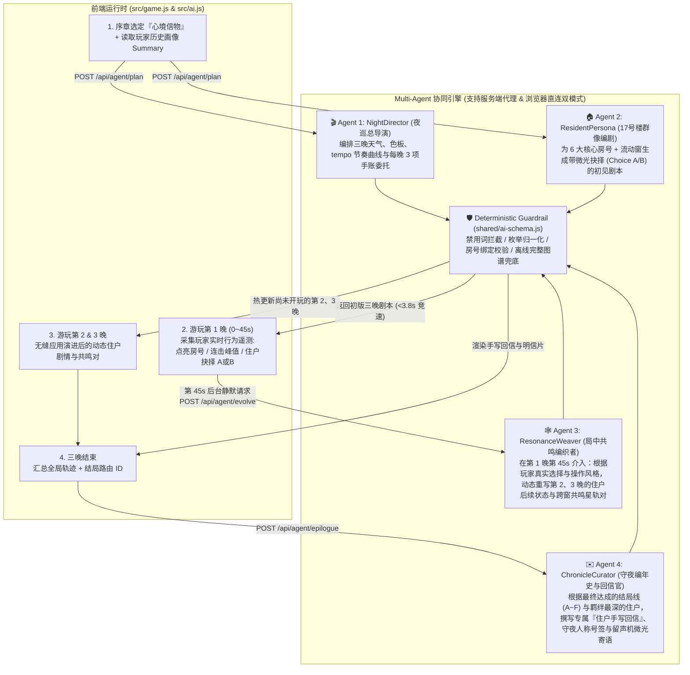
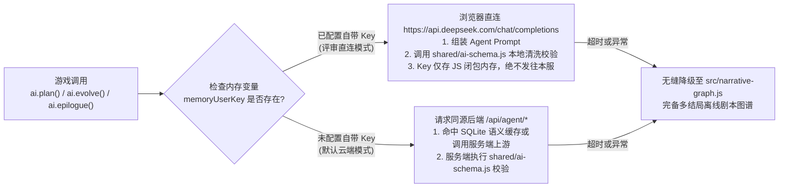

# 02 · 多智能体（Multi-Agent）协同架构、Prompt 工程与双模式容灾规范

> **关联模块**：`server/agents.js`、`shared/ai-schema.js`、`src/ai.js`、`src/narrative-graph.js`  
> **设计目标**：彻底打破 v2「只在开局调一次单 Prompt、局内玩家行为与 AI 零互动」的浅薄模式，构建 **4 大专业智能体协同管线（Director + Persona + Weaver + Curator）**，实现**「开局因人施策 → 局中行为感知与实时剧本演进 → 终局多维度审判与住户手写回信」**的深度 AI 原生游戏体验。

---

## 一、 为什么 v2 的 AI 拿不到「最佳 AI 技术应用奖」？

1. **单次静态生成，与玩家操作完全脱节**：v2 仅在游戏开始前请求一次 `/api/generate`，一旦生成完毕，玩家在游戏里点哪扇窗、连击多少、选了什么分支，对第 2、3 晚的内容**没有任何影响**。
2. **返回字段半数作废**：模型辛苦生成的 `tempo` 字段前端根本没读；`stories` 只是纯文本数组，没有关联具体房间号（`roomId`），也没有提供任何可互动的「微光抉择分支（`choices`）」。
3. **无上下文记忆与跨局状态**：每次刷新都是完全失忆的随机生成，没有利用 4核4G 服务器的 SQLite 存储玩家的「已解锁结局」「偏好节奏」与「跨玩家窗户留声机」。
4. **双模式断层**：文档声称支持用户自带 DeepSeek API Key 浏览器直连，但前端代码根本没有实现。

---

## 二、 v3.0 四大智能体协同管线（4-Agent Collaborative Pipeline）



> **性能与成本兼顾设计**：
> - **开局阶段（`plan`）**：将 `NightDirector` 与 `ResidentPersona` 合并为一次结构化 Multi-Role CoT（思维链）JSON 调用，一次性产出三晚基线剧本与第 1 晚完整抉择分支，耗时控制在 `2.5s ~ 3.8s`。
> - **局中演进阶段（`evolve`）**：在第 1 晚第 `45s`（距离第 1 晚结束还有 30 秒缓冲期！）由后台静默异步发起 `ResonanceWeaver` 请求，耗时 `2s ~ 4s`，在第 2 晚开始前早已就绪，**零加载等待**！
> - **终局回信阶段（`epilogue`）**：在第 3 晚结束播放 3D 结局演出的 `3.5s` 镜头动画期间，并行请求 `ChronicleCurator` 生成专属住户回信。

---

## 三、 四大智能体 Prompt 与 JSON Schema 严格规范

### 3.1 Agent 1 & 2 联合调用：`NightDirector + ResidentPersona`（开局导演与群像生成）

- **接口路径**：`POST /api/agent/plan`（或浏览器直连模式 `runDirectorAgent()`）
- **输入参数（`PlanRequest`）**：
  ```json
  {
    "moodToken": "umbrella",
    "unlockedEndings": ["ENDING_A_WARMTH"],
    "playCount": 2,
    "communityMemory": { "roomId": 304, "text": "窗台上的橘猫打了个哈欠，替你把焦虑接住了。" }
  }
  ```
  - `moodToken` 枚举：`umbrella`（听雨的伞，偏安静慢节奏）、`earphones`（吹风的耳机，偏律动与共鸣）、`quilt`（晒月亮的被子，偏温暖晴夜）、`lamp`（亮着的台灯，偏故事探索）。

- **System Prompt（严禁修改核心约束）**：
  ```text
  你是《今晚，亮一盏灯》的「夜巡总导演 (NightDirector)」兼「17号宿舍楼群像编剧 (ResidentPersona)」。
  你负责根据玩家选择的今夜心境信物与历史档案，编排三个连续校园夜晚的视听参数、手账微委托，以及具有微光抉择分支的窗后故事。

  【铁律与边界】
  1. 只输出严格合法的 JSON，不输出任何 Markdown 代码块标记或多余解释。
  2. 本作是治愈系解压游戏，绝不是心理医疗工具：严禁出现“抑郁、焦虑症、心理疾病、自杀、自残、诊断、治疗、治愈你”等临床或危机词；严禁出现“你应该、想开点、加油、正能量”等居高临下的说教词。
  3. 故事只白描具体、细腻的中国大学宿舍生活切片（声音、光线、小动作、日常器物），允许疲惫、发呆、阴天，不强迫积极。
  4. 固定核心住户设定：
     - 102室(林阿姨·宿管值班室，热茶与钥匙)
     - 203室(小禾·插画系学生，画板与绿萝)
     - 205室(阿澈·广播站主播，麦克风与夜话)
     - 301室(阿满与室友·深夜小电锅关东煮)
     - 304室(知夏·考研学姐与窗外流浪橘猫)
     - 406室(星野·顶楼天文望远镜等流星的少年)
  5. 每晚必须包含：
     - weather: "light_rain" | "fog" | "wind" | "clear"
     - tempo: "slow" | "normal" | "brisk"
     - palette: "rainy_amber" | "warm_blue" | "foggy_lilac" | "clear_peach"
     - commissions: 2~3 项当晚微委托描述（每条 8~18 字）
     - resonancePair: [roomA, roomB] 跨窗共鸣房号对（如 [205, 406] 或 [203, 304]）与一句共鸣描写 resonanceLine（10~26 字）
     - stories: 3 条窗后故事，每条绑定 roomId(102/203/205/301/304/406 之一)，含 text(8~26字)、item(2~6字)、icon(单个Emoji)、以及 2 个微光抉择 choices: [{ label(4~9字), outcome(8~22字) }]
     - postcard: 当晚夜色短句（12~36 字，不要写死具体点亮了几扇窗的数字，以免与玩家实际点亮数冲突！）
  ```

- **输出 JSON Schema（由 `shared/ai-schema.js` 的 `normalizePlanPayload(raw)` 校验）**：
  ```json
  {
    "directorNote": "今夜从微雨开始，慢一点也没关系。",
    "nights": [
      {
        "night": 1,
        "weather": "light_rain",
        "tempo": "slow",
        "palette": "rainy_amber",
        "commissions": [
          { "id": "lit_14", "type": "lit_count", "target": 14, "label": "点亮至少 14 扇窗" },
          { "id": "combo_6", "type": "max_combo", "target": 6, "label": "连成 6 次不断的光链" },
          { "id": "story_1", "type": "story_choice", "target": 1, "label": "回应一扇窗后的小事" }
        ],
        "resonancePair": {
          "rooms": [102, 304],
          "line": "一楼保温桶的热气，顺着雨声飘到了三楼的书桌前。"
        },
        "stories": [
          {
            "roomId": 304,
            "resident": "知夏 · 304室",
            "text": "考研笔记翻到折角那页，窗外空调机上蹲着避雨的橘猫。",
            "item": "橘猫胡须",
            "icon": "🐈",
            "choices": [
              { "id": "A", "label": "推开半扇窗", "outcome": "橘猫抖了抖毛跳进屋，趴在她的错题本边打呼噜。" },
              { "id": "B", "label": "调暖台灯光", "outcome": "暖黄的光晕漫过窗台，替猫咪烘干了淋湿的耳朵。" }
            ]
          }
        ],
        "postcard": "雨丝很细，刚好盖过走廊尽头的脚步声。"
      }
    ]
  }
  ```

---

### 3.2 Agent 3：`ResonanceWeaver`（局中第 45 秒行为感知与后续夜晚动态演进）

- **触发时机**：第 1 晚进行到 `45s` 时（或第 1 晚结算点击「继续第 2 晚」时若未完成），前端携带玩家第 1 晚的**真实交互快照**静默调用 `POST /api/agent/evolve`。
- **输入参数（`EvolveRequest`）**：
  ```json
  {
    "moodToken": "umbrella",
    "night1Telemetry": {
      "litCount": 19,
      "maxCombo": 11,
      "dragChains": 3,
      "resonancesCompleted": 1,
      "choicesMade": [
        { "roomId": 304, "choiceId": "A", "label": "推开半扇窗" },
        { "roomId": 102, "choiceId": "B", "label": "留一份安静" }
      ]
    }
  }
  ```
- **System Prompt**：
  ```text
  你是《今晚，亮一盏灯》的「跨窗共鸣编织智能体 (ResonanceWeaver)」。
  玩家刚刚完成了第 1 晚的守夜。请根据玩家在第 1 晚的真实操作风格（连击高低、是否喜好一笔画拖拽）以及对住户做出的「微光抉择」，动态演进第 2 晚与第 3 晚的住户后续故事与跨窗共鸣！
  要求：
  1. 玩家在第 1 晚帮助/回应过的房号（choicesMade），必须在第 2 或第 3 晚出现温暖的后续因果呼应（蝴蝶效应）。
  2. 若玩家第 1 晚连击很高（maxCombo >= 10），第 2 晚 tempo 设为 "brisk"；若玩家节奏舒缓，则设为 "normal"。
  3. 严禁出现心理诊断词或说教词，只输出严格 JSON（包含更新后的 night 2 与 night 3 对象）。
  ```
- **核心修复（彻底解决 v2 P0-2 的异步覆盖 Bug）**：
  - 在 `src/game.js` 中，当 `evolve` 或慢速 `plan` 返回时，**必须先对 `FALLBACK_NIGHTS` 做 `structuredClone()` 深拷贝**，绝不允许直接修改导出的模块常量！
  - 并且**只替换索引 `> this.nightIndex`（尚未开玩的未来夜晚）**，绝不篡改玩家正在游玩的当前晚状态：
    ```js
    for (let idx = this.nightIndex + 1; idx < NIGHT_COUNT; idx++) {
      if (evolvedNights[idx]) {
        this.nights[idx] = evolvedNights[idx]
      }
    }
    ```

---

### 3.3 Agent 4：`ChronicleCurator`（终局多结局审判、住户手写回信与留声机提炼）

- **触发时机**：第 3 晚结束，前端通过 `resolveEnding()` 计算出本局达成的结局分支（如 `ENDING_C_STARGAZER`）后，在播放 3.5 秒 3D 结局镜头演出的同时调用 `POST /api/agent/epilogue`（超时阈值 `3.5s`，超时立即使用 `src/narrative-graph.js` 中对应结局与住户的高质量预置手写信，绝不卡结算界面）。
- **输入参数（`EpilogueRequest`）**：
  ```json
  {
    "endingId": "ENDING_C_STARGAZER",
    "totalWarmth": 465,
    "litTotal": 62,
    "maxCombo": 18,
    "resonanceCount": 3,
    "stampsEarned": 7,
    "bondRoomId": 406,
    "choicesHistory": [
      { "roomId": 406, "label": "吹散头顶薄云" },
      { "roomId": 304, "label": "推开半扇窗" }
    ]
  }
  ```
- **输出 JSON Schema（`EpilogueResponse`）**：
  ```json
  {
    "archetype": "天台追星守夜人",
    "letter": {
      "fromRoom": "406室 · 星野",
      "salutation": "致今晚帮我吹散云层的人：",
      "body": "十一点四十二分，双子座的第一颗流星真的划过水塔顶上了。谢谢你把四楼的灯连成了一条银河，让我在毕业前的最后一个冬天没有错过它。",
      "sign": "406 窗边的望远镜"
    },
    "whisperSuggestion": "今晚 406 的望远镜里，装下了整栋楼的星光。"
  }
  ```

---

## 四、 比赛合规：「云端智能体代理 + 评审自带 Key 浏览器直连」双模式架构

为同时满足**「日常玩家打开即玩（零门槛）」**与**「赛事评委检验用户自带 DeepSeek API Key 端到端直连（零服务端上传）」**，在 `src/ai.js` 中实现统一的双模式调度器 `AIClient`：



### 4.1 内存态 Key 管理器（`src/ai.js`）实现规范
1. **严禁落盘**：用户输入的 API Key 仅存储在模块私有闭包变量 `let _memoryApiKey = ''` 与 `let _memoryApiBase = 'https://api.deepseek.com/v1'` 中，**绝对禁止**写入 `localStorage`、`sessionStorage`、`Cookie` 或 `window` 全局属性。
2. **真实 Key 最小探针校验（`verifyUserKey(key)`）**：
   - 当用户在标题页「API Key 评审设置」弹窗中输入 `sk-...` 并点击「验证并启用」时，浏览器直接向 `https://api.deepseek.com/v1/chat/completions` 发送一次 `max_tokens: 1` 的最小探针请求。
   - 若返回 HTTP 200，UI 显示绿色徽章 **`「✓ 已启用浏览器直连模式（Key 仅驻留内存）」`**；若返回 401/402，给出清晰中文原因并允许一键切回「云端演示模式」或「离线剧本模式」。
3. **前后端 100% 复用 `shared/ai-schema.js`**：
   - `src/ai.js` 必须显式 `import { normalizePlanPayload, normalizeEvolvePayload, normalizeEpiloguePayload } from '../shared/ai-schema.js'`，使 README 中的架构描述与真实代码 100% 闭合！
