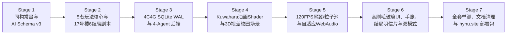

# 06 · 执行模型分阶段施工指令书（Agent Execution Playbook & Acceptance Gates）

> **文档用途**：本文档专门为**后续接手写代码的 AI 执行模型（Execution Model）**编写。  
> **执行原则**：不计 Token 消耗、不省略任何细节、禁止使用 `// TODO` 或简化占位符。必须严格按 **Stage 1 → Stage 7** 的顺序推进，每完成一个 Stage 必须运行对应的验证命令并提交一个语义化 Git Commit。

---

## 零、 全局工程纪律与 Git 规范（最高优先级）

1. **Git 提交身份铁律**：
   每次执行 `git commit` 前，必须确认仓库配置为：
   ```bash
   git config user.name "starflowerH"
   git config user.email "codel323529@163.com"
   ```
   **严禁**出现任何 Bot、AI Agent、noreply 等无关提交者身份。
2. **向后兼容与零回归原则**：
   - 现有的 54 项单元测试（或升级后的 90+ 项单元测试）必须 100% 绿灯通过。
   - `tsconfig.json` 必须开启 `"checkJs": true`，确保 `npm run typecheck` 在真实检查全部 `.js` 源码的情况下 **0 错误**。
   - `npm run lint`（ESLint 9）必须 **0 错误、0 警告**。

---

## 一、 七阶段原子化施工路线图（7-Stage Execution Roadmap）



---

### Stage 1：前后端同构常量库与 AI Schema v3 升级

- **参考规格书**：[01_GAMEPLAY_AND_NARRATIVE_DESIGN.md](file:///c:/Users/29602/Desktop/bu-game-psy/docs/v3_plan/01_GAMEPLAY_AND_NARRATIVE_DESIGN.md)、[02_MULTI_AGENT_AI_ARCHITECTURE.md](file:///c:/Users/29602/Desktop/bu-game-psy/docs/v3_plan/02_MULTI_AGENT_AI_ARCHITECTURE.md)
- **新增 / 修改文件**：
  1. **[新增] `shared/constants.js`**：
     - 导出 `WINDOW_IDS`（24 扇窗的 `idx: 0..23` 与房号 `roomId: 101..406` 双向映射表）。
     - 导出 `CORE_RESIDENT_ROOMS = [102, 203, 205, 301, 304, 406]`。
     - 导出 `WINDOW_STATES = { DARK: 'dark', GLIMMER: 'glimmer', LIT: 'lit', STORY_BEACON: 'story_beacon', RESONANCE_PAIR: 'resonance_pair' }`。
     - 导出 `TEMPO_CONFIG`（`slow` / `normal` / `brisk` 对应的 `initialGlimmer`、`maxGlimmer`、`spawnIntervalMs`、`glimmerDurationMs`、`comboWindowMs`）。
     - 导出 `MOOD_TOKENS`（`umbrella` / `earphones` / `quilt` / `lamp`）与 `ENDINGS`（6 大结局 `ENDING_A_WARMTH` ~ `ENDING_F_DRIFT` 元数据定义）。
  2. **[升级] `shared/ai-schema.js`**：
     - 保留原有的 `BANNED_WORDS`、`WEATHER_MAP`、`TEMPO_MAP`、`PALETTE_MAP`、`ALLOWED_ICONS`（将 `'🍢'` 等缺失图标补入白名单，并处理变体选择符 `\uFE0F`）及 `normalizePayload`（保证旧单测 100% 兼容）。
     - 新增 `normalizePlanPayload(raw)`：校验并归一化三晚导演配置、`commissions`（每晚 3 项手账委托）、`resonancePair`（跨窗共鸣房号对）与带 `roomId` 和 `choices: [A, B]` 的故事数组。
     - 新增 `normalizeEvolvePayload(raw)`：校验 Agent 3 在局中返回的未来夜晚演进数据。
     - 新增 `normalizeEpiloguePayload(raw)`：校验 Agent 4 返回的 `archetype`、`letter`（住户手写回信）与 `whisperSuggestion`（留声机微光寄语）。
     - 新增 `sanitizeWhisper(text)`：用于跨玩家留声机提交时的严格安全过滤（去 HTML/URL、拦截 `BANNED_WORDS`、限制 `6~40` 字）。
- **Stage 1 验收门禁**：
  - 扩展 `tests/ai-schema.test.js` 与 `tests/schema-helpers.test.js`，覆盖所有新增归一化函数；运行 `npm test` 通过。
  - Git 提交：`feat(shared): 建立 v3 同构常量库并升级多智能体 AI Schema 校验`

---

### Stage 2：5 态窗格玩法逻辑与 17 号楼群像多结局剧本图谱

- **参考规格书**：[01_GAMEPLAY_AND_NARRATIVE_DESIGN.md](file:///c:/Users/29602/Desktop/bu-game-psy/docs/v3_plan/01_GAMEPLAY_AND_NARRATIVE_DESIGN.md)
- **新增 / 修改文件**：
  1. **[新增] `src/narrative-graph.js`**：
     - 完整编写 17 号楼 6 位常驻住户（`102 林阿姨`、`203 小禾`、`205 阿澈`、`301 阿满与室友`、`304 知夏与橘猫`、`406 星野`）的三晚状态机剧本树（含初见文本、Choice A / Choice B 选项文案、选择后的即时反馈 `outcome`、以及根据上一晚选择分叉的第 2 晚与第 3 晚演进故事）。
     - 完整编写 18 扇流动窗户的高质量校园切片故事池（不少于 24 条）与跨窗共鸣对剧本库（不少于 6 组）。
     - 完整编写 6 大结局（`ENDING_A_WARMTH` ~ `ENDING_F_DRIFT`）的叙事演出脚本、默认住户手写回信模板与明信片题词库，并提供 `buildOfflinePlan(moodToken, playerRecords)`、`buildOfflineEvolution(night1Telemetry)`、`buildOfflineEpilogue(runSummary)` 三个确定性生成函数，作为 AI 离线或超时时的商业级完备兜底。
  2. **[升级] `src/game-logic.js`**：
     - 保持原有导出函数签名兼容，新增并导出：
       - `gainForDragChain(combo, chainLength)`：一笔画拖拽连亮计分公式。
       - `pickNextGlimmerWindow(windows, coreRoomsPriority, rng)`：智能挑选下一扇进入 `GLIMMER` 的暗窗。
       - `evaluateCommissions(commissions, nightState)`：实时计算当晚 3 项手账委托的完成状态与新盖章项。
       - `resolveEnding(runSummary)`：严格按照 [01_GAMEPLAY_AND_NARRATIVE_DESIGN.md 第五节](file:///c:/Users/29602/Desktop/bu-game-psy/docs/v3_plan/01_GAMEPLAY_AND_NARRATIVE_DESIGN.md) 的优先级判定 6 大结局 ID 与羁绊最深的房号 `bondRoomId`。
- **Stage 2 验收门禁**：
  - 新增 `tests/narrative-graph.test.js` 并扩展 `tests/game-logic.test.js`，验证 6 大结局每一个都能被准确路由触发，验证委托判定与连亮公式；运行 `npm test` 全部通过。
  - Git 提交：`feat(gameplay): 实现 5 态窗格纯逻辑、夜巡手账判定与 17 号楼 6 结局剧情图谱`

---

### Stage 3：4核4G SQLite WAL 全量持久层与 4-Agent 协同后端

- **参考规格书**：[02_MULTI_AGENT_AI_ARCHITECTURE.md](file:///c:/Users/29602/Desktop/bu-game-psy/docs/v3_plan/02_MULTI_AGENT_AI_ARCHITECTURE.md)、[05_BACKEND_PERSISTENCE_AND_DEPLOY.md](file:///c:/Users/29602/Desktop/bu-game-psy/docs/v3_plan/05_BACKEND_PERSISTENCE_AND_DEPLOY.md)
- **新增 / 修改文件**：
  1. **[新增] `server/db.js`**：
     - 封装 Node 22 `DatabaseSync`，开启 `WAL` 模式与 64MB 页缓存。
     - 自动创建 `players`、`runs`、`window_memories`、`window_heat`、`ai_cache`、`telemetry_events` 6 张表，并自动迁移旧版 `scores` 表数据。
     - 提供预编译 CRUD 方法：`getOrCreatePlayer`、`recordRunAndSyncPlayer`、`getLeaderboard(limit, scope)`、`listWindowMemories`、`addWindowMemory`、`likeWindowMemory`、`getGlobalHeatmap`、`getCachedAiPayload`、`setCachedAiPayload`。
     - 数据库为空时，自动在 `window_memories` 与 `window_heat` 中播入 6 条温暖的初始种子留声，确保第一位打开游戏的玩家就能体验到「流光留声机」与热力图效果！
  2. **[新增] `server/agents.js`**：
     - 实现 `NightDirector + ResidentPersona`（`runPlanAgent`）、`ResonanceWeaver`（`runEvolveAgent`）、`ChronicleCurator`（`runEpilogueAgent`）三大服务端上游调用器。
     - 内置 SQLite `ai_cache` 优先命中与回填逻辑，上游失败或未配置 Key 时优雅回退至 `narrative-graph.js` 生成器。
  3. **[升级] `server/index.js`**：
     - 开启 `trustProxy: true`，实现分级令牌桶限流（`aiLimiter` 与 `apiLimiter`）。
     - 挂载 `/api/health`、`/api/ai-health`、`/api/bootstrap`、`/api/agent/plan`、`/api/agent/evolve`、`/api/agent/epilogue`、`/api/generate`、`/api/score`、`/api/leaderboard`、`/api/whispers`、`/api/whispers/:id/like`。
     - 导出 `buildApp({ dataDir, aiKey })` 工厂函数，以便测试脚本在不占用固定端口的情况下直接用 `app.inject()` 进行全链路 API 集成测试！
- **Stage 3 验收门禁**：
  - 新增 `tests/server-api.test.js`，使用 Fastify `inject()` 实测所有 API 端点（档案创建与找回、分数提交、结局持久化、留声机封存与点赞、限流器、AI 降级）；运行 `npm test` 全绿。
  - Git 提交：`feat(server): 构建 SQLite WAL 六表持久化架构、跨玩家留声机与 4-Agent 协同接口`

---

### Stage 4：次世代 Kuwahara 油画后期 Shader、3D 视差室内窗与 Blender 管线

- **参考规格书**：[03_ART_BLENDER_AND_SHADER_PIPELINE.md](file:///c:/Users/29602/Desktop/bu-game-psy/docs/v3_plan/03_ART_BLENDER_AND_SHADER_PIPELINE.md)、[04_INTERACTION_VFX_AND_120FPS_ENGINE.md](file:///c:/Users/29602/Desktop/bu-game-psy/docs/v3_plan/04_INTERACTION_VFX_AND_120FPS_ENGINE.md)
- **新增 / 修改文件**：
  1. **[重写] `src/painterly.js`**：
     - 实现 4-Sector Anisotropic Kuwahara 油画笔触滤波 + 双尺度手绘抖动彩色墨线（群青/焦茶/暖金勾边）+ 程序化亚麻画布 Impasto 法线受光高光 + 水粉暖纸暗部托底 + 雨夜模式屏幕空间滑落水滴折射（`uRainAmount` uniform 控制）。
  2. **[新增] `src/vfx-pool.js`**：
     - 实现容量 `1024` 的单 `THREE.Points` GPU 环形粒子池，替代旧版每次点击 `new THREE.BufferGeometry()` 的 `_burst` 逻辑；提供 `emitBurst`、`emitResonanceBridge`（绘制并保持跨窗共鸣星桥）与 `update(time)`。
  3. **[升级] `src/scene.js`**：
     - 将 24 扇窗升级为 **3 层 3D 视差结构（外框反光玻璃 + 中层动态角色/生活剪影 + 底层暖色背板）**，并为 6 大核心住户绘制专属初见/演进双态厚涂纹理。
     - 完整支持窗户 5 种状态（`DARK` / `GLIMMER` 手绘旋转光环 / `LIT` / `STORY_BEACON` 金色信标 / `RESONANCE_PAIR` 双子星轨弧桥）的 3D 视觉渲染。
     - 增加左前景复古路灯与丁达尔体积光锥、顶点着色器风场摇曳树冠、一楼宿管温馨黑板与单车、屋顶天台星空剧场。
     - 实现二阶弹簧阻尼鼠标/陀螺仪 3D 视差（`Second-Order Spring Parallax`）、连击 FOV 呼吸脉动（`pulseCameraFov`）、以及 **6 大结局专属 3D 镜头演出动画**（如 `playEndingCutscene('ENDING_C_STARGAZER')` 平滑推镜头上天台仰望银河、`ENDING_E_DAWN` 夜空实时渐变为金粉破晓朝霞、`ENDING_D_HARMONY` 全楼 24 窗音律波浪闪烁）。
  4. **[新增] `tools/blender/build_campus_v3.py`**：
     - 编写升級版 Blender Python 脚本，生成带圆润倒角、外廊、水塔、路灯与 24 扇独立命名窗户的校园微缩模型。
- **Stage 4 验收门禁**：
  - 确保 `npm run build` 与 `npm run typecheck` 无报错，所有 Shader 语法合法、Uniform 类型严格对齐。
  - Git 提交：`feat(art): 重写 Kuwahara 厚涂油画后期管线、3D 视差窗格与结局镜头演出系统`

---

### Stage 5：120FPS 流体拖拽尾翼、自适应 WebAudio 交响引擎与双模 AI 客户端

- **参考规格书**：[02_MULTI_AGENT_AI_ARCHITECTURE.md](file:///c:/Users/29602/Desktop/bu-game-psy/docs/v3_plan/02_MULTI_AGENT_AI_ARCHITECTURE.md)、[04_INTERACTION_VFX_AND_120FPS_ENGINE.md](file:///c:/Users/29602/Desktop/bu-game-psy/docs/v3_plan/04_INTERACTION_VFX_AND_120FPS_ENGINE.md)
- **新增 / 修改文件**：
  1. **[新增] `src/ribbon-trail.js`**：
     - 实现基于环形缓冲区与 Catmull-Rom 样条插值的 120FPS Canvas 2D 流体拖拽尾翼（支持普通微光游丝、按住一笔画宽金光带、窗户磁吸偏移与点亮瞬态高光脉冲）。
  2. **[新增] `src/audio-engine.js`**：
     - 实现 4 层自适应 WebAudio 合成器：天气环境音（细雨/晚风滤波调制）+ 随 `litCount` 动态渐入的大七和弦温暖 Pad 层 + 五声音阶马林巴点击与一笔画竖琴刮奏（Glissando）+ 6 大住户专属微拟音彩蛋（猫呼噜、关东煮气泡、电台调频、风铃等）。
  3. **[升级] `src/ai.js`**：
     - 显式导入 `shared/ai-schema.js` 中的校验函数。
     - 实现内存态 API Key 管理器（`setUserApiKey`、`getUserApiKeyStatus`、`verifyUserApiKey`，Key 仅驻留闭包内存，绝不落盘）。
     - 实现统一支持「服务端代理」与「浏览器直连 DeepSeek」的双模式接口：`requestInitialPlan`、`requestMidGameEvolution`、`requestEndingEpilogue`。
  4. **[升级] `src/records.js`**：
     - 支持本地 `localStorage` 与服务端 `/api/bootstrap`、`/api/score` 双向同步，管理 `uid`、`passCode`、`unlockedEndings`、`residentBonds`、`items`、`titles` 与 `history`。
- **Stage 5 验收门禁**：
  - 更新 `tests/records.test.js`，运行 `npm run lint` 与 `npm test` 全绿。
  - Git 提交：`feat(engine): 新增 Catmull-Rom 流体拖拽尾翼、自适应四层音效引擎与双模 AI 调度器`

---

### Stage 6：主控业务流闭环、高刷毛玻璃 UI、手账火漆章、结局树与油画明信片

- **参考规格书**：[01_GAMEPLAY_AND_NARRATIVE_DESIGN.md](file:///c:/Users/29602/Desktop/bu-game-psy/docs/v3_plan/01_GAMEPLAY_AND_NARRATIVE_DESIGN.md)、[04_INTERACTION_VFX_AND_120FPS_ENGINE.md](file:///c:/Users/29602/Desktop/bu-game-psy/docs/v3_plan/04_INTERACTION_VFX_AND_120FPS_ENGINE.md)
- **新增 / 修改文件**：
  1. **[重写/升级] `src/game.js`**：
     - 彻底修复核心玩法循环：`_scheduleNextGlimmer` 将暗窗变为 `GLIMMER`（或 `STORY_BEACON` / `RESONANCE_PAIR`），到期未点自动温和退回 `DARK`；玩家通过单击或**一笔画拖拽（`onWindowDragPass`）**唤醒窗户变为 `LIT`。
     - 修复 `Esc` 键在 `night` 和 `paused` 状态下均可切换暂停。
     - 接入 `night.tempo` 控制微光生成节奏；在每晚第 `45s` 静默调用 `requestMidGameEvolution` 动态演进后续夜晚（深拷贝、仅更新未开玩夜晚）。
     - 当 `litCount === 24` 时可靠触发 `_allLit()`，并在 1.8 秒后若剩余时间充足开启「安可流光（Encore）」模式。
     - 第 3 晚结束调用 `resolveEnding()`，驱动 3D 结局演出 + Agent 4 住户手写回信 + 明信片渲染。
  2. **[升级] `src/ui.js` & `src/style.css`**：
     - **全部图标 SVG 化**（彻底消除 Emoji 豆腐块）。
     - **标题首屏**：展示全服共亮进度条与实时微光留言跑马灯；提供「开始守夜」「结局星图 & 住户图鉴」「今夜排行榜 & 留声机」「AI 模式 / 评审 Key 设置」入口。
     - **序章心境信物选择面板**：4 张手绘油画风信物卡（听雨的伞 / 吹风的耳机 / 晒月亮的被子 / 亮着的台灯）。
     - **局内 HUD**：脏值比对零抖动更新 + `scaleX` 温暖进度条 + 24 窗点亮格子矩阵指示器 + 左上角**「今夜手账微委托（带动态朱砂火漆盖章动效）」**。
     - **非阻塞「窗后故事与微光抉择卡」**：冻结连击计时器 5 秒，提供 Choice A / B 两个微光抉择胶囊按钮，并展示偶遇的跨玩家留声微光（可点赞共鸣）。
     - **终局结算与明信片页**：展示达成的结局徽章（如 `【结局 C · 屋顶的银河】`）、**住户手写回信信纸**、1080×1440 高清明信片、**「将今夜微光封存进窗户（流光留声机）」**互动组件、以及今日榜/总榜/个人档案切换。
  3. **[升级] `src/postcard.js`**：
     - **真实映射玩家本局点亮的窗户分布**（不再用 `Math.random()` 乱画），根据达成的 6 大结局绘制专属油画天际线配色（星空紫金 / 破晓朝霞 / 琥珀星桥等），印上住户手写回信摘录、守夜人称号印章与手绘信物徽章。
  4. **[升级] `src/main.js` & `index.html` & `public/favicon.svg`**：
     - 组装 `RibbonTrail`、拖拽滑动检测与 `Scene` / `Game` / `UI`；补齐 SVG Favicon。
- **Stage 6 验收门禁**：
  - 开启 `tsconfig.json` 的 `"checkJs": true`，修复所有 JSDoc 类型标注直至 `npm run typecheck` 为 **0 错误**。
  - Git 提交：`feat(game,ui): 完整闭环 5 态点滑玩法、微光抉择、6 大结局演出与高刷毛玻璃 UI`

---

### Stage 7：全量验证、文档焕新与 `hynu.site` 自动化部署包

- **参考规格书**：[05_BACKEND_PERSISTENCE_AND_DEPLOY.md](file:///c:/Users/29602/Desktop/bu-game-psy/docs/v3_plan/05_BACKEND_PERSISTENCE_AND_DEPLOY.md)
- **新增 / 修改文件**：
  1. **[新增] `deploy/nginx-hynu.conf`、`deploy/light-a-window.service`、`deploy/deploy.sh`**：
     - 编写面向 `hynu.site` 的完整部署配置与含自动备份、健康检查、一键回滚（`--rollback`）的部署脚本。
  2. **[更新] `README.md`、`CHANGELOG.md`、`PRIVACY.md`**：
     - 将仓库门面文档全面更新为 v3.0 商业化重制版架构说明，替换所有旧域名为 `https://hynu.site`，详细阐述 4-Agent 智能体架构、双模式 API Key 验证与隐私保护、Kuwahara 油画渲染管线、6 大多结局 IF 线与 4核4G 持久化方案。
- **Stage 7 终极验收门禁（Final Gate）**：
  - 运行 `npm run verify`（依次执行 `eslint .` → `tsc -p tsconfig.json --noEmit` → `vitest run` → `vite build`），必须 **0 Error、0 Warning、测试 100% 通过、生产包构建成功**！
  - Git 提交：`docs,deploy: 更新 v3.0 完整项目文档并交付 hynu.site 自动化部署套件`

---

## 二、 给执行模型的一键启动 Prompt（直接复制发送给执行 Agent）

你可以将以下 Prompt 直接复制给任何无限 Token 的执行模型（如 Claude Code / Codex / Cursor）：

```text
请作为首席全栈与图形学工程师，严格按照本仓库 `docs/v3_plan/` 目录下的 7 份架构与产品规格书（`00_MASTER_BLUEPRINT.md` 至 `06_EXECUTION_PLAYBOOK_FOR_AGENTS.md`），执行《今晚，亮一盏灯 · Light A Window》v3.0 商业化重制版的全量代码升级。

执行要求：
1. 动工前先完整阅读 `docs/v3_plan/00_MASTER_BLUEPRINT.md` 至 `06_EXECUTION_PLAYBOOK_FOR_AGENTS.md` 全部 7 份文档。
2. 严格遵守 Git 身份规范：所有 commit 的 user.name 必须为 `starflowerH`，user.email 必须为 `codel323529@163.com`。
3. 严格按照 `06_EXECUTION_PLAYBOOK_FOR_AGENTS.md` 中定义的 Stage 1 → Stage 7 顺序逐步实现，绝不允许写空壳占位符、TODO 或删减需求特性：
   - Stage 1: 完成 `shared/constants.js` 与 `shared/ai-schema.js` v3 升级并补齐单测；
   - Stage 2: 完成 `src/narrative-graph.js`（17号楼 6 大住户三晚分支剧本 + 6 大结局完备离线图谱）与 `src/game-logic.js`（5 态窗格、一笔画连亮计分、手账委托判定、6 结局路由算法）并补齐单测；
   - Stage 3: 完成 `server/db.js`（SQLite WAL 6 表持久化与种子数据）、`server/agents.js`（4-Agent 协同管线与语义缓存）与 `server/index.js`（开启 trustProxy、分级限流、留声机与全服热力图 API）并通过 API 集成测试；
   - Stage 4: 重写 `src/painterly.js`（4-Sector Kuwahara 油画滤波 + 彩色手绘墨线 + Impasto 画布受光 + 雨滴折射）、新增 `src/vfx-pool.js`（1024 容量零 GC GPU 粒子池）、升级 `src/scene.js`（3D 视差室内窗、5 态视觉、体积光路灯、二阶弹簧镜头视差、6 大结局专属镜头演出）并编写 `tools/blender/build_campus_v3.py`；
   - Stage 5: 新增 `src/ribbon-trail.js`（Catmull-Rom 120FPS 拖拽流体尾翼与磁吸）、`src/audio-engine.js`（四层自适应 WebAudio 交响与住户拟音）、升级 `src/ai.js`（服务端代理 + 浏览器内存 Key 直连双模式）与 `src/records.js`（云端通行证双向同步）；
   - Stage 6: 全面升级 `src/game.js`、`src/ui.js`、`src/style.css`、`src/postcard.js`、`src/main.js`，开启 `tsconfig.json` 的 `checkJs: true` 并确保零类型错误；
   - Stage 7: 编写 `deploy/` 下的 `hynu.site` 部署与回滚套件，更新 `README.md` 与 `CHANGELOG.md`，最后运行 `npm run verify` 确保 lint、typecheck、单元测试、生产构建全绿通过。
4. 每完成一个 Stage，运行测试验证并创建一个清晰的语义化 Git Commit。现在请从 Stage 1 开始执行，直到 Stage 7 全部完成并通过 `npm run verify`。
```
