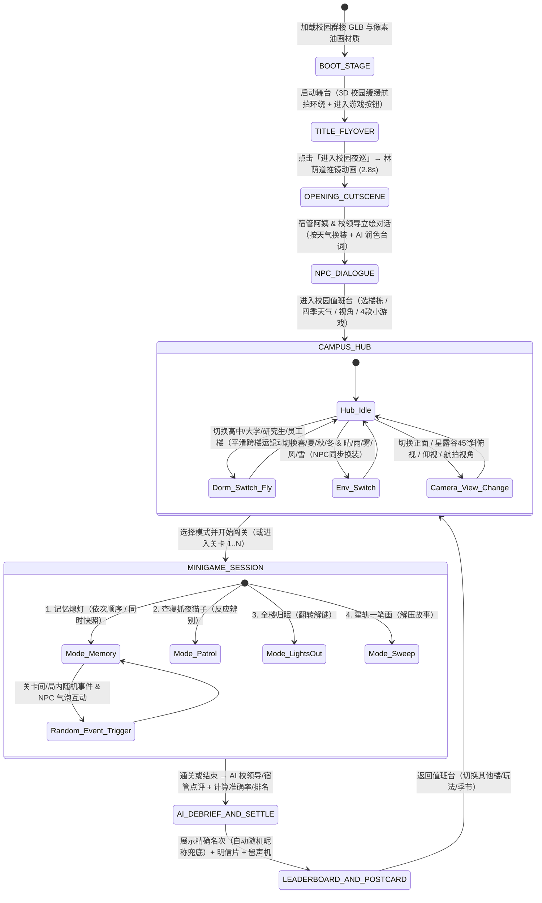

# 00 · 《今晚，亮一盏灯 v4.0 · 星露谷 3D 校园夜巡物语》升级总纲与架构蓝图

> **文档定位**：本目录（`docs/v4_plan/`）为基于当前 `v3.0.0` 代码基线的 **v4.0 全面演进架构与产品规格书**。  
> **核心升级方向**：从单一 3D 方盒大楼 + 纯油画模糊 + 单一解压点击，升级为 **「星露谷 3D 微缩写实像素油画风 × 4 栋可切换校园宿舍楼 × 四季与真实物理天气 × 宿管/校领导具象剧情对话 × 4 大目标性益智/解压小游戏矩阵 × 高存在感 AI 导演系统」**。

---

## 一、 基于现行 `v3.0.0` 代码的真实问题诊断（Must Fix）

在全面读取当前仓库源码后，发现以下必须彻底解决的技术与体验断点：

1. **Blender 模型根本没进游戏（虚实脱节）**：
   - 仓库中已经存在 `tools/blender/build_campus_v3.py` 与 `public/models/dorm_v3.glb`，但 `src/scene.js` 的 `_buildDorm()` 依然使用原生 `new THREE.BoxGeometry(BW, BH, BD)` 硬编码方盒，**全项目没有任何地方加载过 `.glb` 模型**！
2. **雾天表现极其敷衍（假雾+滤镜）**：
   - `src/scene.js` 第 1380 行 `setWeatherFx('fog')` 直接写着 `this.snow.visible = true`（用雪花粒子假装雾气！）加上极弱的 `FogExp2`，毫无夜晚校园潮湿流动的真实雾感。
3. **纯油画涂抹过糊，缺少星露谷式 3D 立体生活感**：
   - 当前 Kuwahara 滤波偏涂抹卡通，且建筑仅有一栋光秃秃的楼，无法切换视角观察校园周边，没有四季变化，也没有高中/大学/研究生/教职工等差异化建筑。
4. **缺乏目标性与益智挑战深度**：
   - 当前仅有点击/一笔画解压玩法，虽然舒缓但缺乏记忆、反应、逻辑策略上的闯关目标感与并列小游戏矩阵，重玩抓手不足。
5. **人物剧情引出不足、AI 存在感偏弱**：
   - 缺少开场动画进入按钮与「宿管阿姨 + 校领导」面对面立绘对话引出「熄灯助眠」主旨；NPC 也不会随天气换装；AI 基本藏在后台，玩家感知不到大模型在实时出题、演绎随机事件与赛后点评。
6. **排行榜缺少清晰自身定位与随机昵称**：
   - 未起名直接叫「今晚的某某」缺乏趣味；打开榜单也无法一眼看到自己当前排第几名、在哪一档、按哪个玩法/楼栋排名。

---

## 二、 v4.0 核心设计支柱（Four Pillars）

| 支柱 | 核心升级点 |
|---|---|
| **视觉与 3D 场景** | **星露谷 3D 微缩写实风格（像素油画质感材质 × 真实 PBR 立体砖瓦屋檐门廊 × 适度微笔触后期）**；利用 **Blender MCP** 实景制作 4 栋差异化宿舍楼 GLB 并在同一微缩校园场景真正加载；支持 **4 档看楼视角 + 自由阻尼轨道观察 + 平滑切楼航拍动效**；**春/夏/秋/冬四季 + 晴/雨(水洼涟漪)/真体积流雾/风/雪**全真实天气。 |
| **角色、剧情与装扮** | 启动页 3D 校园巡航动画 +「进入校园夜巡」入口；开场林荫道推镜演出 + **宿管林阿姨、夜巡校领导（周副校长）、电工王师傅及 5 位核心住户**具象立绘对话；**所有 NPC 随当前天气×季节自动更换服装**（雨衣撑伞、防风风衣提手电、羽绒服围巾等）；丰富局内随机事件触发实时对话。 |
| **目标性多款小游戏矩阵** | 以「熬夜失眠 · 熄灯护航」为主题，打造 **4 款并列楼房主题小游戏**： 1. **记忆熄灯夜巡**（依次亮起考顺序准确率 / 一起亮起考空间准确率，随关卡加灯减时闯关） 2. **查寝夜猫子**（快节奏辨别违规蓝紫游戏窗与安全学习暖窗） 3. **全楼归眠矩阵**（经典 Lights-Out 十字翻转逻辑解谜 + GF(2) 步数评分） 4. **星轨一笔画**（保留并升级原 5 态连光与住户故事解压模式） |
| **显性 AI + 持久化排名** | **AI 导演实时可见**：开场/切楼/事件实时对白生成 + 智能关卡阵型设计 + 赛后校领导/宿管个性化点评；未取名自动分配趣味校园随机昵称；排行榜按**小游戏 × 宿舍楼**分榜并置顶**「我的实时排名定位卡」**；基于 4C4G SQLite WAL 持久化全部闯关成绩、图鉴、NPC 好感与留声机记忆。 |

---

## 三、 v4.0 主状态机（Master Flow）

---

## 四、 v4.0 规划分卷导航

| 分卷 | 文件名 | 核心内容 |
|---|---|---|
| **卷 01** | [01_MINIGAMES_AND_PROGRESSION.md](file:///c:/Users/29602/Desktop/bu-game-psy/docs/v4_plan/01_MINIGAMES_AND_PROGRESSION.md) | 4 大楼房益智/解压小游戏详尽规则、数学难度曲线、准确率算法、10 大随机事件 |
| **卷 02** | [02_STORY_NPCS_AND_WEATHER_OUTFITS.md](file:///c:/Users/29602/Desktop/bu-game-psy/docs/v4_plan/02_STORY_NPCS_AND_WEATHER_OUTFITS.md) | 开场动画、宿管阿姨/校领导等 8 位 NPC 扩充剧情、天气×季节换装差分、AI 对话系统 |
| **卷 03** | [03_STARDEW_3D_BLENDER_SEASONS_WEATHER.md](file:///c:/Users/29602/Desktop/bu-game-psy/docs/v4_plan/03_STARDEW_3D_BLENDER_SEASONS_WEATHER.md) | 星露谷 3D 美术与 Shader 改造、Blender MCP 4 栋楼建模规格、切楼动效、4 视角、真体积雾与雨雪四季 |
| **卷 04** | [04_VISIBLE_AI_AGENTS_AND_LEADERBOARD.md](file:///c:/Users/29602/Desktop/bu-game-psy/docs/v4_plan/04_VISIBLE_AI_AGENTS_AND_LEADERBOARD.md) | 显性 AI 存在感架构、AI 关卡/点评/事件生成、随机昵称与精准排名定位排行榜、SQLite v4 扩表 |
| **卷 05** | [05_EXECUTION_PLAYBOOK_V4.md](file:///c:/Users/29602/Desktop/bu-game-psy/docs/v4_plan/05_EXECUTION_PLAYBOOK_V4.md) | Blender MCP 与工程代码分阶段执行指令书、验收门禁与一键启动 Prompt |
