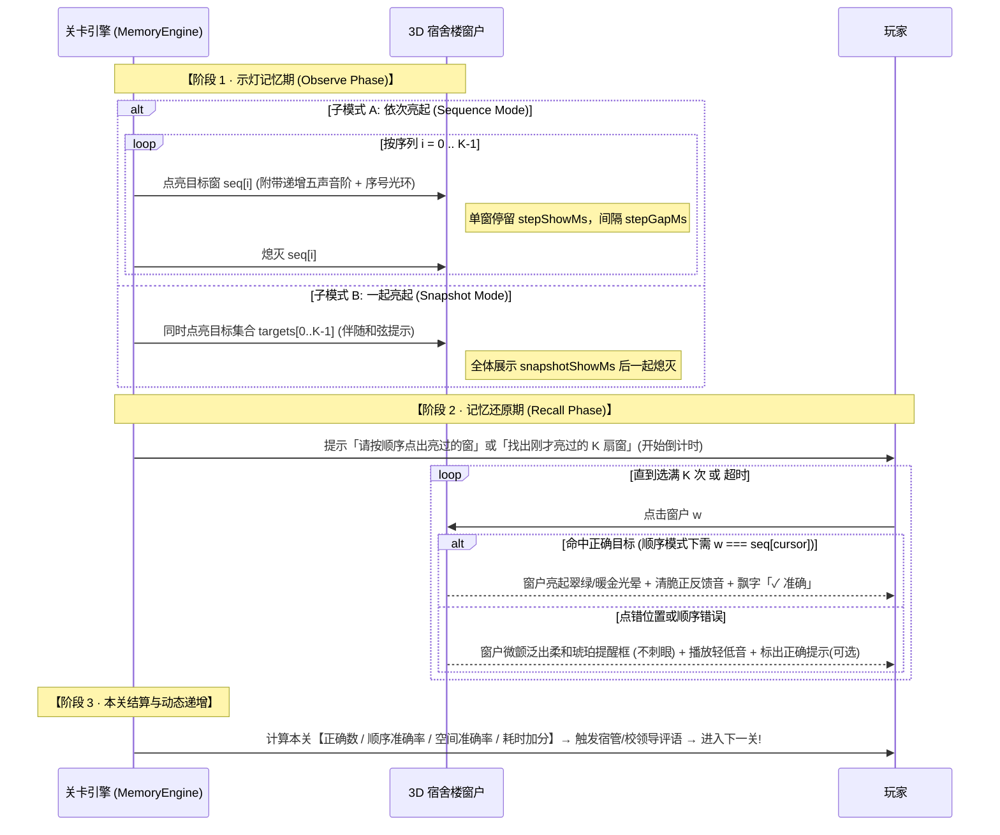

# 01 · 目标性益智玩法重构与四大并列楼房小游戏矩阵

> **设计背景**：围绕**「夜间熄灯 · 告别熬夜失眠」**主题，将原本单一的点击解压升级为**有明确目标、有准确率/顺序考核、有难度递增闯关、有随机事件**的多模式益智休闲小游戏合集，同时保留治愈连光玩法作为休闲分支。

---

## 一、 四款并列楼房主题小游戏总览

在进入校园值班台后，玩家可在底部/侧边精美木牌切换栏自由选择以下 **4 款基于同一栋 3D 宿舍楼窗户网格**的玩法（且任意玩法都可搭配任意 4 种宿舍楼 × 4 季节 × 5 天气！）：

| 模式 ID | 中文名称 | 核心玩法与考核指标 | 适配楼栋规模（自动适配窗数） |
|---|---|---|---|
| `memory_sequence` / `memory_snapshot` | **1. 记忆熄灯 · 夜巡点亮** *(主推核心)* | 先观察窗户亮灯，灯灭后精准还原： - **依次亮起（顺序模式）**：考点击顺序 + 正确数/准确率 - **一起亮起（快照模式）**：考空间记忆准确率 + 用时 | 员工楼 `12窗`（入门） 高中楼 `18窗`（标准） 大学楼 `24窗`（经典） 研究生楼 `30窗`（大师） |
| `patrol_reflex` | **2. 查寝夜猫子 · 火眼金睛** | 宿管与校领导联合查寝反应战：快速熄灭违规打游戏蓝紫闪屏窗，守护正在合规自习/值班的暖黄灯，点亮晚归走廊灯 | 全楼通用 |
| `lights_out_puzzle` | **3. 全楼归眠 · 熄灯棋盘** | 经典十字翻转益智解谜：点一扇窗会翻转自身与上下左右四邻窗，用最少步数令整栋楼全灭安睡（或全亮晨起） | 全楼通用（内置 $GF(2)$ 求解器保证 100% 可解） |
| `star_sweep` | **4. 星轨一笔画 · 暖光连线** | 升级保留 v3 的 5 态一笔画光链、跨窗共鸣与住户微光抉择，纯治愈零压力解压模式 | 全楼通用 |

---

## 二、 主推玩法详规：「记忆熄灯 · 夜巡点亮」（Memory Night Patrol）

### 2.1 背景叙事
临近熄灯点名，总有几间宿舍在偷偷熬夜或忘了拉闸。你需要**趁走廊灯最后一次扫过时记住哪些宿舍还亮着（或先后亮起的顺序）**，等全楼陷入黑暗后，精准点击对应窗户完成「温柔熄灯/登记安睡」。

### 2.2 两种子模式精确流程

### 2.3 关卡难度递增公式（Level 1 → Level 15+ 无尽闯关）

设当前楼栋总窗数为 $W$（$W \in \{12, 18, 24, 30\}$），当前关卡为 $L$（从 1 开始）：

1. **亮灯数量 $K(L)$**：
   $$K(L) = \min\left(\lfloor W \times 0.65 \rfloor, \; 3 + \lfloor (L - 1) \times 0.8 \rfloor\right)$$
   - 第 1 关仅亮 **3 扇**，极易上手；第 5 关亮 **6 扇**；第 10 关亮 **10 扇**；研究生 30 窗楼最高可达 **19 扇**！
2. **显示时间逐步缩短**：
   - **依次亮起模式（Sequence）**：
     - 单窗亮起时长：$T_{\text{step}}(L) = \max(320, \; 850 - (L - 1) \times 45)\text{ ms}$
     - 相邻亮起间隔：$T_{\text{gap}}(L) = \max(90, \; 260 - (L - 1) \times 15)\text{ ms}$
   - **一起亮起模式（Snapshot）**：
     - 全体展示时长：$T_{\text{snap}}(L) = \max(900, \; 3000 - (L - 1) \times 170)\text{ ms}$
3. **高阶干扰机制（第 4 关起解锁）**：
   - **假闪干扰窗（Decoy Flicker）**：展示期间可能有 `1 ~ 2` 扇窗以**冷蓝色微弱闪烁**（非目标暖光），或窗外路灯闪一下，考验专注力。
   - **AI 星座阵型关（每逢第 3、6、9…关）**：由 AI `PuzzleArchitect` 生成具有语义形状的灯阵（如「北斗七星」「笑脸」「爱心」「阶梯」），伴随特别提示「注意，同学们今晚拼了个图案！」。

### 2.4 精确指标与评分体系
每关结束后，实时统计并展示以下 4 个清晰数字（也是排行榜的硬核依据）：
- **总正确数 (`correctCount`)**：本局累计准确点出的窗户总数。
- **准确率 (`accuracyRate`)**：$\frac{\text{correctCount}}{\text{totalAttempts}} \times 100\%$（`0% ~ 100%`）。
- **顺序完美度 (`orderAccuracy`，仅依次亮起模式)**：完全按照正确顺位命中的比例；全对触发 **`「过目不忘 · PERFECT」`** 全楼金色波浪祝贺！
- **综合闯关得分 (`score`)**：
  $$\text{StageScore} = \text{correctCount} \times 100 + \text{perfectBonus} + \lfloor \text{timeLeftSec} \times 15 \rfloor \times \text{difficultyMult}$$
  - 闯关生命值（耐心值）：玩家拥有 **3 颗星灯护盾**（单关失误率超过 50% 消耗 1 颗；满分通关可回复 1 颗；即使 3 颗用完也不会弹出冰冷的 Game Over 骂人界面，而是宿管阿姨笑着说*「今晚大家都困啦，先记到这里，明天再接再厉」*并正常出结算榜与 AI 点评！）。

---

## 三、 并列小游戏 2：「查寝夜猫子 · 火眼金睛」（Dorm Patrol Reflex）

- **背景**：熄灯铃响半小时后，宿管阿姨和校领导突击巡楼，帮他们把还在熬夜打游戏的房间劝睡，同时不要打扰合规报备的安静同学。
- **三种实时冒出的窗户信号（每局 60 秒快节奏波次）**：
  1. **🎮 违规夜猫子窗（蓝紫 RGB 闪烁 + 窗内电脑屏幕剪影）**：必须迅速点击将其熄灭（`+15 分`，连击加倍）。若超过 `2.6s` 未灭会传染邻窗一起熬夜。
  2. **📖 合规暖灯窗（柔和米黄台灯 + 书本剪影）**：比如考研学姐或宿管值班室，**千万不能点熄**！误点会弹出住户探头气泡*「啊我还在写论文呢！」*并中断连击（无恶意惩罚）。
  3. **🌙 晚归留门微光窗（虚线钥匙图标闪烁）**：需要玩家主动点亮为晚归同学留一盏灯（`+25 分`）。
- **结算指标**：劝睡成功数、误点率、最高连击、总分。

---

## 四、 并列小游戏 3：「全楼归眠 · 熄灯棋盘」（Lights-Out Logic Matrix）

- **背景**：老宿舍楼的电路串联在一起，拉下某间房的总闸会影响相邻几间房的灯。用最少步数让整栋楼顺利安睡！
- **规则**：
  - 点击坐标 $(r, c)$ 的窗户，会同时翻转 $(r, c)$ 以及上下左右相邻最多 4 扇窗的开关状态（亮 $\leftrightarrow$ 灭）。
  - 关卡从 **2 步可解（新手引导）→ 4 步 → 6 步 → 8+ 步**逐步推进。
- **工程铁律（100% 可解保障）**：
  - 关卡盘面全部采用**「从全灭目标态反向随机点击 $k$ 次生成」**，或通过 $GF(2)$ 高斯消元校验，**100% 保证每一关都有解**！
  - 提供「向宿管阿姨求助（AI 提示一步）」按钮，调用内置 $GF(2)$ 求解器直接高亮下一个最优点击窗户，绝不卡死玩家。

---

## 五、 局内随机事件系统（Random Events）

在所有闯关模式（尤其是记忆熄灯与查寝模式）中，每 `2~3` 关或局内特定时刻，以 `30%` 基础概率触发 **10 大校园随机事件**（伴随立绘气泡 + 3D 场景动效）：

| 事件 ID | 事件名称 | 触发人物与台词示例 | 玩法与视觉即时影响 |
|---|---|---|---|
| `evt_dean_inspect` | **校领导突击陪巡** | 周副校长：*「小同学记性不错，这轮我记双倍学分表扬！」* | 接下来 1 关得分 **×1.5**，楼前出现路灯高亮 |
| `evt_aunt_tea` | **宿管送来热姜茶** | 林阿姨：*「天凉喝口姜茶，刚才那盏看漏的阿姨帮你补上。」* | 恢复 **1 颗星灯护盾**（或自动豁免 1 次点错） |
| `evt_power_flicker` | **老楼电路瞬跳** | 电工王师傅：*「稳住！刚合上闸，先给大家多亮一秒！」* | 全楼灯光闪一下，本关展示记忆时间 **+0.8 秒** |
| `evt_cat_window` | **流浪橘猫踩窗台** | 橘猫喵呜一声蹲在某扇正确窗台上舔爪子 | 相当于直接**免费帮玩家揭晓 1 扇正确窗**！ |
| `evt_meteor_wish` | **夜空流星划过** | 星野（406）：*「快看水塔那边！今晚一定顺顺利利！」* | 天空划过流星粒子，连击翻倍 |
| `evt_midnight_snack` | **301 深夜煮面香** | 阿满（301）：*「嘘——谁闻到红烧牛肉面味了？」* | 301 窗飘出白色热气，本关额外加 `+50` 趣味分 |
| `evt_fog_surge` | **校园夜雾突然变浓** | 场景地面涌起一层浓厚体积流动白雾 | 雾气浓度短暂加强，考验眼力（雾夜专属高概率） |
| `evt_rain_bell` | **屋檐雨滴协奏** | 雨滴砸在地面水洼泛起大片金色涟漪 | 五声音阶切换为清脆雨铃音色 |
| `evt_late_student` | **晚归同学敲门** | 林阿姨：*「刚自习回来的孩子，快帮他把一楼门灯点着！」* | 额外出现限时门灯加分点（`+100`） |
| `evt_ai_pattern` | **AI 神秘灯阵** | AI 导演：*「今晚同学们约好了在楼面上摆了个暗号~」* | 亮灯位置组成心形 / 箭头 / 星座连线等好记几何图形 |
