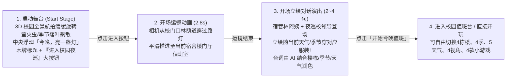

# 02 · 剧情扩充、具名角色立绘对话与 NPC 天气四季换装体系

> **设计目标**：回应用户关于「剧情继续扩充，引入宿管阿姨、校领导等具体人物对话引出」「开场启动动画与进入按钮」「不同天气 NPC 要有不同服装」的核心诉求，打造有血有肉、充满校园生活喜剧感与治愈感的 RPG 叙事壳子。

---

## 一、 游戏启动演出与开场剧情流（Startup → Cutscene → Dialogue）

### 1.1 开场对话脚本范式（多人物交替登场，非干瘪旁白）
对话系统 `DialogueOverlay` 支持 **左侧/右侧双角色立绘同时出场（说话者高亮放大，未说话者微暗退后）+ 打字机气泡 + 跳过按钮 + 选项回复**：

- **经典开场示例（大学宿舍楼 · 雨夜 · 秋季）**：
  1. **林阿姨（宿管 · 穿着明黄色雨衣、手撑小伞）**：
     *「哟，小夜巡员来啦！外头下着秋雨呢，快进门厅躲躲。今晚这帮孩子又在熬夜刷手机不肯睡了……」*
  2. **周副校长 / 陈老师（夜巡校领导 · 披着深蓝防风衣、提着复古手电筒）**：
     *「林阿姨说得对，最近同学失眠的多。一会儿熄灯前咱们再复查一遍——小同学，你帮着记住刚才哪些宿舍还亮着灯，等拉了总闸，咱们温柔地去敲敲窗提醒他们早点睡！」*
  3. **玩家互动选项（2选1，直接决定首局加成）**：
     - `[ ✦ 没问题，先从顺序记忆开始！ ]` → 直接进入「依次亮起」记忆模式，获得校领导赞许。
     - `[ ✧ 我想先看看全楼，或者换栋楼巡查 ]` → 进入校园值班大厅自由切换楼栋/季节/小游戏。

---

## 二、 8 位具名 NPC 角色与「天气×季节」换装矩阵

### 2.1 角色阵容扩充（管理组 + 住户组）

| 角色 ID | 姓名与身份 | 性格与台词风格 | 主要出场时机 |
|---|---|---|---|
| `aunt_lin` | **林阿姨 · 宿管值班员** | 刀子嘴豆腐心、随身带保温桶和一大串黄铜钥匙 | 开场引导、护盾回复、局内提示、每晚结算 |
| `dean_zhou` | **周主任 / 周副校长 · 夜巡校领导** | 一本正经又带着点老派幽默的关心、爱背着手巡查 | 开场任务布置、突击查寝随机事件、赛后 AI 评分点评 |
| `uncle_wang` | **王师傅 · 后勤电工** | 爽朗接地气、永远挎着帆布工具包 | 跳闸随机事件、熄灯棋盘解谜提示、切楼电闸动效 |
| `xiaohe` | **小禾 · 大学楼 203 插画生** | 敏感细腻、爱用画本记录亮灯的楼 | 大学楼剧情事件、明信片主笔 |
| `ache` | **阿澈 · 大学楼 205 广播站主播** | 声音好听、毕业季留恋校园 | 大学/研究生楼共鸣事件、音乐节拍互动 |
| `aman` | **阿满 · 301 夜宵大王** | 搞笑乐观、永远在研究深夜泡面配方 | 抓夜猫子常客、深夜食堂随机事件 |
| `zhixia` | **知夏 · 研究生楼/304 科研学姐** | 认真自律、养着一只总蹲窗台的流浪橘猫 | 研究生楼/大学楼剧情、橘猫提示事件 |
| `xingye` | **星野 · 高中楼/406 天文少年** | 好奇心强、拿着望远镜在雨缝里等流星 | 高中楼剧情、天台流星事件、员工楼邻里彩蛋 |

### 2.2 NPC 五套「天气×季节」动态换装规范（Wearable Outfit System）
每个角色对象拥有统一的外观渲染器 `renderNpcPortrait(roleId, weather, season, mood)`（同时支持**高精度分层 SVG/Canvas 动态穿衣立绘** + **优先加载预生成分层 WebP 立绘**，保证 100% 不破图！）：

| 环境状态 (`outfitKey`) | 触发条件 | 服装与道具视觉特征（肉眼一眼分辨） |
|---|---|---|
| `sunny_light`（晴夏轻便装） | 晴天/大风 + 春/夏 | 短袖衬衫/值班Polo衫、草帽或发卡、校领导拿文件夹、宿管端搪瓷茶杯 |
| `rain_gear`（雨夜雨衣装） | 小雨 / 暴雨 | 半透明磨砂雨衣或明黄色连帽雨衣、手里撑起对应色系雨伞（伞面带高光水珠）、雨靴 |
| `fog_coat`（浓雾夜巡装） | 雾夜 | 深卡其/藏青长风衣（立领）、手里举着**散射出锥形光束的暖光手电筒**、颈挂小哨子 |
| `autumn_knit`（秋风针织装） | 秋季（晴/风） | 温暖格子围巾、针织毛衣开衫、衣角随风微微飘动动画、手捧热烤红薯或热茶 |
| `winter_puffer`（冬雪御寒装） | 冬季 / 雪夜 | 蓬松面包羽绒服或厚呢大衣、毛线护耳帽、鼻尖微红、呼出淡淡白色哈气粒子、怀抱暖手宝 |

### 2.3 3D 校园场景中的小人偶联动（Stardew 3D Living Campus）
不仅在对话框里有换装立绘，在 **3D 宿舍楼一楼门口/林荫道路灯下**，还会站立着 **Q 版像素油画风格的 3D 宿管阿姨 / 校领导小人偶（或 Billboard 像素小人精灵）**：
- 切换天气为「雨天」时，门口的小人偶立刻撑起一把黄伞！
- 切换季节为「冬天」时，小人偶换上羽绒服戴上红围巾，头顶偶尔冒出温馨的小气泡（`💬` / `☕` / `🎵`）！

---

## 三、 四栋宿舍楼各自的专属小剧情线

切换不同宿舍楼时，不仅建筑外观和窗户数变了，**开场对话与住户风味也完全不同**：
1. **高中宿舍楼（18 窗 · 晚自习后熄灯冲刺）**：
   - 主题：晚自习十点半刚下课，宿管拿着大喇叭提醒「别躲被窝打手电背单词啦」，校领导在楼下巡查防熬夜。
2. **大学宿舍楼（24 窗 · 17号楼的温暖夜色）**：
   - 主题：经典的自由夜生活——画画的、播电台的、煮关东煮的、看星星的，热闹又温柔。
3. **研究生宿舍楼（30 窗 · 深夜实验室归来）**：
   - 主题：赶论文、跑代码、调实验数据归来的学长学姐们，窗户亮得更晚更安静，需要更贴心的守夜记忆与助眠提醒。
4. **教职工/员工宿舍楼（12 宽窗 · 烟火温情）**：
   - 主题：老师和后勤叔叔阿姨的家属楼——阳台上晒着被子、厨房亮着温牛奶的灯、石桌旁蹲着几只学校里的流浪猫。
